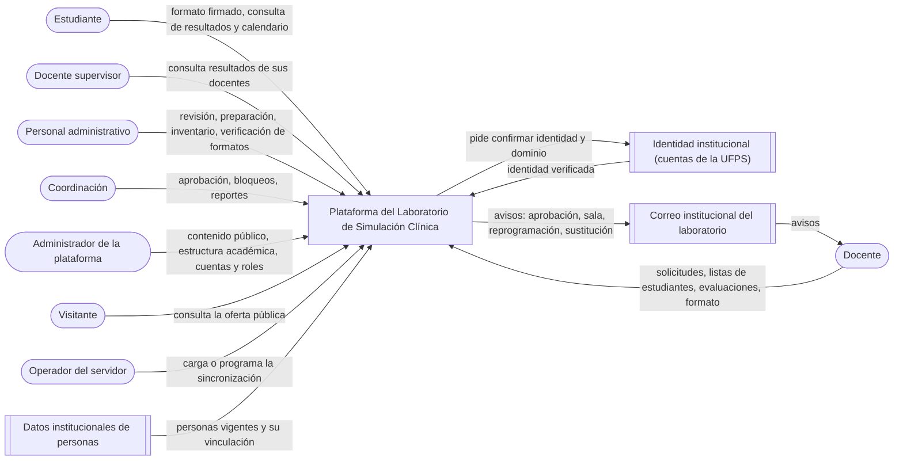
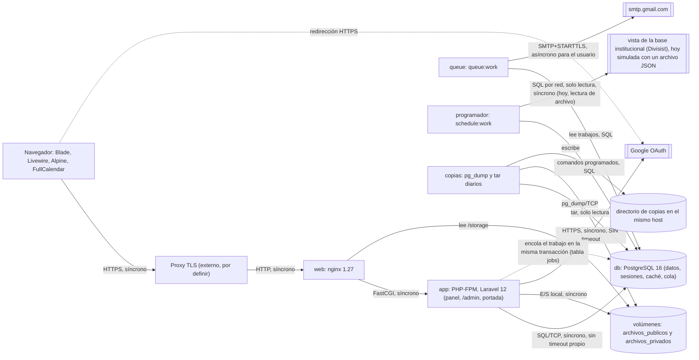

# Auditoría de arquitectura y seguridad: plataforma del Laboratorio de Simulación Clínica

- **Fecha:** 2026-11-06
- **Alcance:** rama `claude/new-session-ljd2ib`, commit `e167456` (último del historial disponible: 2026-10-29).
- **Tipo:** diagnóstico de las secciones 1 a 6, hecho sobre `e167456` sin tocar código. Las correcciones posteriores, con sus commits, están en la sección 7. Se versiona desde el 2026-11-08, a pedido del desarrollador.
- **Estado del reporte:** completo (fase 0, B4, S, B3, B1, B0, B6, B2 y B5). Respuestas del cliente del 2026-11-06 al 2026-11-08 incorporadas.

Convenciones: `ruta:línea` es evidencia del código; `[SUPUESTO por confirmar: …]` marca una cifra que no sale del repo; los ejemplos con personas son inventados.

---

## 1. Resumen

**La autorización está bien resuelta: no encontré ningún hallazgo bloqueante.** Ningún ID cambiado permite leer ni modificar lo ajeno: Policies por objeto, re-autorización en cada petición de Livewire, IDs con `#[Locked]` y falla cerrada. Los riesgos están en cinco frentes:

- la contención sobre un mismo registro;
- la disponibilidad cuando Google tarda;
- el privilegio de la cuenta de base de datos;
- lo que exige la Ley 1581;
- dos decisiones de contexto que el repo contradice.

| Bloque | Cumple | Cumple parcialmente | No cumple | No aplica | No verificable | Total |
|---|---|---|---|---|---|---|
| B4 Seguridad y modificabilidad | 1 | 4 | 0 | 0 | 0 | 5 |
| S Seguridad complementaria | 6 | 3 | 0 | 0 | 1 | 10 |
| B3 Tácticas | 2 | 5 | 3 | 2 | 0 | 12 |
| B1 Anti-patrones y deuda (B1.1 cuenta sus 7 anti-patrones) | 2 | 7 | 1 | 1 | 1 | 12 |
| B0 Fundamentos | 3 | 3 | 2 | 0 | 0 | 8 |
| B6 Del escenario a la prueba (sin B6.7, que es la propuesta) | 0 | 5 | 1 | 0 | 0 | 6 |
| B2 y B5 Modelo de lenguaje | 0 | 0 | 0 | 14 | 0 | 14 |
| **Total** | **14** | **27** | **7** | **17** | **2** | **67** |

De los 34 criterios que no cumplen o cumplen a medias: **0 bloqueantes, 12 importantes y 22 sugerencias.**

**Los cinco hallazgos más graves, en orden:**

1. **B3.11, asignar sala sin bloqueo** (importante). Dos administrativos pueden reservar la misma sala para sesiones que se cruzan, y los dos docentes reciben el correo. Lo mismo, con menos probabilidad, en la capacidad del escenario y el número de intento (`PreparacionService.php:71-90`).
2. **B3.1, Google sin timeout** (importante). Veinte entradas lentas retienen los 20 workers de PHP-FPM hasta 150 s y dejan sin servicio **todo** el panel. Además, un error de Google termina en 500 (`config/services.php:40-45`, `docker/php/www.conf`).
3. **S.1, la aplicación entra a PostgreSQL como superusuario** (importante). `app`, `queue`, `programador` y `copias` usan el `POSTGRES_USER` del contenedor; una inyección o una ejecución remota sería `DROP DATABASE` o comandos en el servidor.
4. **B4.2 y S.10, Ley 1581** (importante). Ninguna descarga de un formato firmado ni exportación de resultados queda registrada; no hay forma de atender consultas ni supresiones; y lo ajeno responde 403, lo que confirma que existe.
5. **B1.5, S.7 y B3.8, decisiones de despliegue sin escribir** (importante). Confirmaste (2026-11-06) que el despliegue es en el servidor institucional, como dice `CLAUDE.md`, y que la plataforma copiará los usuarios a su propia base desde una vista de la base de la UFPS. Ninguna de las dos decisiones está en un ADR, y esa conexión por red todavía no tiene definidos TLS ni timeout. Además, el TLS no está definido, las copias quedan sin cifrar en el mismo servidor y, detrás de un proxy, los topes de nginx por IP pasan a ser de toda la universidad.

---

## 2. Mapa del sistema (fase 0)

### 2.1 Stack con versiones y comandos

| Capa | Tecnología y versión | Origen |
|---|---|---|
| Lenguaje | PHP 8.3 (imagen `php:8.3.36-fpm-bookworm`; `config.platform.php` fijo en 8.3.0) | `docker/php/Dockerfile:27-28`, `composer.json` |
| Framework | Laravel 12.70.2 | `composer.lock` |
| Interfaz del panel | Blade + Livewire 3.8.8 + Alpine (124 vistas Blade) | `composer.lock`, `resources/views` |
| Panel del ADMIN | Filament 3.3.55, en `/admin` | `composer.lock`, `app/Providers/Filament/AdminPanelProvider.php` |
| Base de datos | PostgreSQL 16 | `docker-compose.produccion.yml` (servicio `db`) |
| Roles | spatie/laravel-permission 8.3.2 (solo roles; no se usan permisos del paquete) | `composer.lock`; `grep givePermissionTo` sin resultados |
| Entrada | Laravel Socialite 5.31.0 (Google) | `composer.lock` |
| Exportación | dompdf 3.1.6 (vía barryvdh 3.1.2), maatwebsite/excel 4.0.6 (PhpSpreadsheet 5.10.0) | `composer.lock` |
| Front | Vite 6.4.3, Tailwind 3.4.19, FullCalendar 6.1.21 | `package-lock.json` |
| Pruebas y análisis | Pest 3.8.7 (PHPUnit 11), Larastan 3.13.2 nivel 6 con línea base, Pint | `composer.lock`, `phpstan.neon` |
| Contenedores | Docker Compose: desarrollo (`docker-compose.yml`) y producción (`docker-compose.produccion.yml`) | raíz del repo |

**Discrepancia de documentación:** `CLAUDE.md` (§2) dice `spatie/laravel-permission ^7.1`; `composer.json` pide `^8.3` y el lock tiene 8.3.2 (subida de Dependabot, commit `98cfbff`).

Comandos (de `CLAUDE.md` §9 y `README.md`), todos dentro de Docker:

```bash
docker compose up -d
docker compose exec app php artisan migrate:fresh --seed
docker compose exec app php artisan test
docker compose exec app vendor/bin/phpstan analyse
docker compose -f docker-compose.produccion.yml up -d --build
```

### 2.2 Estructura de carpetas

`app/` tiene 296 archivos PHP y 22 953 líneas (`find app -name '*.php' | wc -l` y `cat | wc -l`). Las capas siguen `CLAUDE.md` §3: ruta → middleware → controlador o componente Livewire → Policy → Service → modelo → evento → listener → correo.

| Carpeta | Contenido | Archivos |
|---|---|---|
| `app/Http/Controllers` | 16 del panel, 3 de autenticación y la portada; solo autorizan y devuelven vistas o descargas | 21 |
| `app/Livewire` | 29 componentes, que concentran todas las acciones que cambian datos del panel, y 2 traits | 31 |
| `app/Policies` | 29 Policies, una por modelo | 29 |
| `app/Services` | 43 archivos: Services de negocio y DTO (`Datos*`, `Resultado*`, `PersonaInstitucional`) | 43 |
| `app/Models` | modelos Eloquent | 43 |
| `app/Filament` | 12 recursos, 2 páginas y la base `RecursoDelAdmin` | 59 |
| `app/Enums`, `app/Exceptions` | estados y tipos; excepciones de dominio | 21 + 18 |
| `database/migrations` | migraciones | 66 |
| `tests` | 94 archivos Feature y 3 Unit | 97 |

### 2.3 Roles según el código

Seis roles (`app/Enums/Rol.php:9-14`). En cada petición rige **un solo rol**, el activo: `RolActivo::aplicar()` reemplaza en memoria la relación `roles` por la del rol elegido (`app/Support/RolActivo.php:165-171`), y el middleware `EstablecerRolActivo` lo aplica también en `/livewire/update` (`app/Providers/AppServiceProvider.php:67-70`). Los roles con fecha de fin vencen en SQL dentro de `User::roles()`.

| Rol | Qué le dejan hacer las Policies | Qué no puede, aunque se esperaría |
|---|---|---|
| `admin` | Todo `/admin` (Gate `accederAlPanelDelAdmin`, `AppServiceProvider.php:95`); cuentas, roles y supervisión (`UserPolicy`, `AsignacionDeRolPolicy`, `SupervisionPolicy`); aprobar o rechazar solicitudes revisadas (`SolicitudPolicy::resuelveSolicitudes`); bandeja de solicitudes; reportes (Gate `generarReportes`, `AppServiceProvider.php:112`); bitácora; bloqueos; inventario completo, incluidos dar de baja y el nivel de fidelidad; periodo académico; verificar formatos; cerrar listas de reposición; plantillas del formato | Revisar solicitudes pendientes, preparar escenarios, sesiones apartadas, reprogramar o sustituir (todas exigen administrativo o coordinador: `SolicitudPolicy::revisaSolicitudes`, `PreparacionPolicy::montaEscenarios`) |
| `coordinador` | Las dos fases de la solicitud, reprogramar, sustituir, sesiones apartadas, formato intramural, preparación, inventario (dar de baja sí, fidelidad no), periodo, verificar formatos, cerrar reposición, bloqueos, bitácora, reportes, todas las evaluaciones y calendario completo | `/admin`, cuentas y roles |
| `administrativo` | Revisar o rechazar pendientes, reprogramar y sustituir aprobadas, sesiones apartadas, formato intramural, preparación (asignar sala, alistar), inventario (cambiar estado y retirar), **abrir, cerrar y reabrir el periodo académico** (`PeriodoAcademicoPolicy`), verificar y rechazar formatos y marcar la entrega física, anotar y atender necesidades de reposición, participantes de cualquier sesión, calendario completo | Reportes, bitácora, bloqueos, dar de baja, cerrar la lista de reposición |
| `docente` | Crear solicitudes, ver y gestionar los participantes de las suyas (como `docente_id` o `docente_que_dicta_id`, `SolicitudPolicy::esSuya`), registrar evaluaciones en las sesiones que dicta (`EvaluacionPolicy::registrarEnSesion`), ver sus evaluaciones, entregar su formato, su calendario | Ver la disponibilidad del inventario (regla 5) |
| `supervisor` | Resultados finalizados de los docentes que el ADMIN le asignó, en pantalla, PDF y Excel (`EvaluacionPolicy::supervisar`, `SupervisionService::filtroDe`) | Todo lo demás |
| `estudiante` | Sus resultados (`EvaluacionEstudiantePolicy`), entregar su formato, su calendario (sesiones donde está en la lista) | Todo lo demás |
| Cualquiera con sesión | Descargar la plantilla en blanco del formato (`PlantillaConfidencialidadPolicy::descargar` devuelve `true`) | — |

### 2.4 Inventario de rutas

Fuente: `routes/web.php` (195 líneas), los 29 componentes Livewire y los recursos de Filament. Todas las rutas del panel van bajo `auth`, `usuario.activo` y `rol.activo` (`routes/web.php:91`). Los parámetros que resuelven modelos son numéricos (`routes/web.php:39-41`). **En el panel, ninguna ruta GET cambia datos**: no hay escrituras en los controladores (`grep` de `update/save/delete/create/attach` en `app/Http/Controllers` sin resultados). Todo cambio entra por `POST /livewire/update`, que vuelve a pasar por `VerificarUsuarioActivo` y `EstablecerRolActivo` y por el trait `AutorizaEnCadaPeticion` (`app/Livewire/Concerns/AutorizaEnCadaPeticion.php:29-32`), que repite el permiso de la pantalla en cada petición.

**Públicas y de entrada**

| Método | Ruta | Manejador | Sesión | Autorización | IDs |
|---|---|---|---|---|---|
| GET | `/` | `PortadaController@inicio` | No | Pública; solo lo publicado | — |
| GET | `/escenarios/{escenario}` | `PortadaController@escenario` | No | `visiblesEnPublico()->findOrFail` → 404 si no está publicado (`PortadaService.php:77-82`) | Sí |
| GET | `/acceso`, `/acceso/google`, `/acceso/google/volver` | `AccesoConGoogleController` | No | 404 sin `GOOGLE_CLIENT_ID`; `state` de Socialite; `email_verified` y `hd` en `AccesoService::cuentaDeGoogle` | — |
| POST | `/salir` | `SalirController` | Opcional | CSRF | — |
| GET | `/up` | health de Laravel | No | Pública | — |
| GET/POST | `/desarrollo/acceso` | `AccesoDeDesarrolloController` | No | Solo `APP_ENV=local`, comprobado al registrar (`routes/web.php:190`) y en cada petición (`SoloEnDesarrollo`) | Sí (`usuario`) |

**Panel `/panel`: solicitudes y sesiones**

| Método | Ruta o acción | Manejador | Autorización | IDs del cliente |
|---|---|---|---|---|
| GET | `mis-solicitudes` | `MisSolicitudes` | `create` Solicitud (docente); lista con `Auth::user()` (`MisSolicitudes.php:43`) | — |
| GET | `solicitudes/nueva` | `FormularioSolicitud` | `create` Solicitud | — |
| acción | `agregarEstudiante`, `quitarEstudiante`, `quitarItem`, `guardar` | `FormularioSolicitud` | `create` en `guardar`; el Service exige estudiantes activos con rol, equipos existentes, caso de la materia y capacidad (`SolicitudService.php:88-122`) | `estudianteId`, `itemId`, `materiaId`, `casoClinicoId` |
| GET | `solicitudes` | `BandejaRevision` | `verBandeja` (administrativo, coordinador, admin) | — |
| GET | `solicitudes/{solicitud}` | `ExpedienteDeSolicitud` | `view`: dueño o bandeja (`SolicitudController.php:58`) | `solicitud` |
| acción | `revisar`, `aprobar`, `rechazar` | `ExpedienteDeSolicitud` | Policy por objeto; transición con `lockForUpdate` (`SolicitudService.php:611-617`) | `solicitudId` con `#[Locked]` |
| GET | `solicitudes/{solicitud}/participantes` | `ParticipantesDeLaSesion` | `view` | `solicitud` |
| acción | `agregar`, `retirar` | `ParticipantesDeLaSesion` | `gestionarParticipantes` en el componente y otra vez en el Service (`SolicitudService.php:134,162`) | `estudianteId` |
| GET | `solicitudes/{solicitud}/formato-intramural` | `FormatoIntramural` | `registrarFormatoIntramural` (administrativo o coordinador, aprobada) | `solicitud`, `itemId` |
| GET | `solicitudes/{solicitud}/novedades` | `NovedadesDeLaSesion` | `reprogramar` y `sustituirDocente` | `solicitud` |
| GET | `sesiones-apartadas` | `SesionesApartadas` | `registrarApartada`; `registrar` valida `docenteId` como docente activo (`RegistroPrevioService.php:281-288`) | `docenteId`, `materiaId`, `casoClinicoId` |
| GET | `calendario`, `calendario/eventos` | `CalendarioController` | `verCalendario`; la consulta se filtra por rol y por defecto no devuelve nada (`SolicitudService.php:532-542`); rango máximo de 62 días | — |
| POST | `rol-activo` | `SelectorDeRolController` | Solo un rol que la persona tenga vigente (`RolActivo::establecer`) | — |

**Panel: evaluaciones, supervisión y reportes**

| Método | Ruta o acción | Manejador | Autorización | IDs del cliente |
|---|---|---|---|---|
| GET | `evaluaciones` | `Evaluaciones` | `viewAny` Evaluacion | — |
| acción | `registrar` | `Evaluaciones` | `create` y `registrarEnSesion` (el docente que dicta, `EvaluacionPolicy`) | `solicitudId`, tipo |
| GET | `evaluaciones/{evaluacion}` | `RegistroDeEvaluacion` | `view`: dueño, admin o coordinador | `evaluacion` (`#[Locked]`) |
| acción | `agregar`, `quitar`, `alternarItem`, `resultado`, `guardarObservaciones`, `finalizar` | `RegistroDeEvaluacion` | `registrar` o `finalizar` (dueño); registros e ítems acotados a la evaluación (`RegistroDeEvaluacion.php:78,148-154`) | `estudianteId`, `registroId`, `itemId` |
| GET | `mis-resultados` | `MisResultados` | `viewAny` EvaluacionEstudiante (estudiante); lista con `Auth::user()` | — |
| GET | `supervision`, `supervision/excel`, `supervision/pdf` | `SupervisionController` | `supervisar`; el docente pedido se cruza con los asignados en la base (`SupervisionService.php:173-186`) | `docente`, `periodo` (query) |
| GET | `reportes`, `reportes/{reporte}/excel`, `reportes/{reporte}/pdf` | `ReporteController` | Gate `generarReportes` (admin, coordinador); `throttle:descargas` | Filtros en la query |
| GET | `bitacora` | `BitacoraController` | `viewAny` (coordinador, admin) | — |

**Panel: operación del laboratorio**

| Método | Ruta o acción | Manejador | Autorización | IDs del cliente |
|---|---|---|---|---|
| GET | `preparaciones` | `TableroDiario` | `viewAny` Preparacion (administrativo, coordinador) | — |
| acción | `abrir`, `asignarSala`, `alternarItem`, `cambiarEstado`, `guardarObservaciones` | `TableroDiario` | Policy por objeto, según el rol (`TableroDiario.php:72-153`) | `preparacionId`, `itemId`, `salaElegida` |
| GET | `inventario`, `inventario/nuevo`, `inventario/{item}/editar`, `inventario/disponibilidad` | `InventarioController` | `viewAny`, `create` y `update` (admin, coordinador, administrativo) | `item` |
| acción | `pedirCambioDeEstado`, `confirmarCambioDeEstado` | `ListadoInventario` | `cambiarEstadoFuncional` o `darDeBaja`; fila bloqueada en el Service (`InventarioService.php:376`) | `itemId`, origen, destino, cantidad |
| acción | `guardar` | `FormularioItem` | `create` o `update`; el nivel de fidelidad solo si `editarNivelFidelidad` (`FormularioItem.php:164-166`) | `simuladorId` |
| acción | `consultar` | `ConsultaDisponibilidad` | `viewAny` ItemInventario | `itemId` |
| GET | `reposicion`, `reposicion/{lista}/excel`, `reposicion/{lista}/pdf` | `ReposicionController`, `ListaDeReposicion` | `viewAny` y `exportar`; solo listas cerradas, si no 404 (`ReposicionController.php:49-50`) | `lista`, `necesidadId`, `itemId` |
| GET | `bloqueos` | `GestionDeBloqueos` | `viewAny`, `create` y `levantar` (coordinador, admin) | `personaElegida`, `bloqueoId` |
| GET | `periodo-academico` | `GestionDePeriodos` | `create`, `cerrar` y `reabrir` (admin, coordinador, administrativo) | `periodoId` |

**Panel: formato de confidencialidad y cuentas**

| Método | Ruta o acción | Manejador | Autorización | IDs del cliente |
|---|---|---|---|---|
| GET | `mi-formato` | `MiFormato` | `create` (estudiante, docente); PDF validado por contenido y de hasta 5 MB (`MiFormato.php:44`) | — |
| GET | `formatos-confidencialidad` | `BandejaVerificacion` | `viewAny` (administrativo, coordinador, admin); `verificar` y `rechazar` por objeto, con fila bloqueada (`ConfidencialidadService.php:605`) | `entregaId` |
| GET | `formatos-confidencialidad/estado` | `EstadoDeFirmantes` | `viewAny`; `marcarEntregaFisica` | `firmanteId` |
| GET | `formatos-confidencialidad/{entrega}/documento` | `DescargaConfidencialidadController@firmado` | `descargar`: el firmante o quien verifica (`FormatoConfidencialidadPolicy`); `throttle:descargas` | `entrega` |
| GET | `formatos-confidencialidad/plantilla`, `/plantilla/{plantilla}` | `DescargaConfidencialidadController` | Vigente: cualquiera con sesión; versión: `view` (admin) | `plantilla` |
| GET | `plantillas-confidencialidad` | `GestionDePlantilla` | `create` PlantillaConfidencialidad (admin) | — |
| GET | `usuarios`, `usuarios/nueva`, `usuarios/{cuenta}/editar` | `RolesDeUsuarios`, `FormularioDeCuenta` | Solo admin (`AsignacionDeRolPolicy`, `UserPolicy`) | `usuarioId`, `cuenta` |
| GET | `usuarios/{supervisor}/supervision` | `DocentesSupervisados` | `gestionar` Supervision (admin) | `supervisor`, `docenteId` |

**`/admin` (Filament):** 12 recursos (caso clínico, certificación, equipo destacado, estadística, evento, galería, materia, perfil docente, sala, taller, tipo de evaluación y tipo de evento) y 2 páginas (ajustes y configuración de la portada). El acceso lo decide el Gate del ADMIN con el rol activo (`User::canAccessPanel`, `app/Models/User.php:246-249`). Cada acción pasa por la Policy del modelo, y `RecursoDelAdmin::$shouldCheckPolicyExistence = false` hace que una Policy ausente niegue en vez de permitir. Las páginas tienen `canAccess()` y vuelven a autorizar al guardar (`AjustesDelLaboratorio.php:44-46,81`). Los IDs de registro llegan en la URL, pero todo es del ADMIN y no hay dueños que separar.

**Comandos y tareas programadas** (`routes/console.php`): `sesiones:avisar-formato-intramural` todos los días a las 06:00 y `usuarios:sincronizar`, con la frecuencia de `SINCRONIZACION_FRECUENCIA` (por defecto `0 2 * * *`), solo si `SINCRONIZACION_PROGRAMADA=true` (`routes/console.php:23-52`).

### 2.5 Dependencias externas

| Dependencia | Para qué | Protocolo | Síncrona | Timeout |
|---|---|---|---|---|
| PostgreSQL 16 | Datos, sesiones, caché, cola y bloqueos (`SESSION_DRIVER`, `CACHE_STORE` y `QUEUE_CONNECTION` = `database`) | TCP 5432, PDO; `sslmode=prefer` (`config/database.php:97`) | Sí | Sin `connect_timeout` ni `statement_timeout`; el único tope es `request_terminate_timeout = 150s` de PHP-FPM (`docker/php/www.conf`) |
| Google OAuth (Socialite) | Entrada (RF18) | HTTPS: redirección del navegador e intercambio servidor a servidor del código y del perfil | Sí, en `/acceso/google/volver` | **Ninguno**: `config/services.php:40-45` no define `guzzle.timeout`, y Guzzle no limita por defecto. Tope efectivo: los 150 s de FPM |
| SMTP de Google (`smtp.gmail.com:587`) | Correos (RF33, RF36, RF60, RF61, RF73, aviso de RF20) | SMTP con STARTTLS | **Asíncrona** para el usuario: listeners `ShouldQueue` (`app/Listeners/*.php:17,20`) y `Mail::queue` | `timeout => null` (`config/mail.php:48`); toma `default_socket_timeout` de PHP [SUPUESTO por confirmar: 60 s, el valor por defecto, que `php-produccion.ini` no cambia]; el worker corta a los 90 s (`--timeout=90`) |
| Disco local (volúmenes `archivos_publicos` y `archivos_privados`) | Imágenes y videos públicos; formatos firmados | E/S local, `Storage::disk` | Sí | No aplica |
| Fuente institucional | Altas, cambios y bajas de cuentas (RF19, RF20) | Hoy lee el archivo `database/datos/institucional-simulada.json`; la real no existe (`AppServiceProvider.php:36-46`). Será SQL por red contra una vista de la base de la UFPS, de solo lectura (motor por definir) | Sí, dentro del comando programado y fuera de la petición del usuario | No aplica con el archivo; la conexión a la vista necesitará timeout de conexión y de consulta |
| Proxy TLS | HTTPS | Externo, por definir (`README.md`, §HTTPS) | — | — |
| Modelos de lenguaje, pagos, brokers de mensajería | — | **No existen** en el código | — | — |

**La copia semestral de Divisist no aparece en el repo.** No hay ninguna mención a "Divisist" ni a una copia semestral. El código y la documentación describen otra cosa: una sincronización programada, diaria por defecto, contra una vista institucional por red con un usuario de solo lectura (`docs/trazabilidad.md`, «Bloqueos externos», puntos 1 a 4; `config/laboratorio.php:39`). **Aclaración del 2026-11-06:** la UFPS dará una **vista** de su base (Divisist) con los campos que se le pidieron, todavía sin entregar. La plataforma se conectará a esa vista y copiará los datos a su propia base, en el servidor de la aplicación, distinto del de Divisist. Es el diseño que ya tiene el repo (`FuenteInstitucional` y `usuarios:sincronizar`). Esa conexión cruza la red: necesita TLS, un usuario de solo lectura y timeout. Ver B1.5.

### 2.6 Pruebas

- **Framework:** Pest 3.8.7 sobre PHPUnit 11, con base PostgreSQL real (`laboratorio_simulacion_testing`, `phpunit.xml:27`) y `RefreshDatabase`.
- **Cantidad:** 97 archivos (94 Feature y 3 Unit), con 1 239 declaraciones `it(` o `test(` (`grep -rhoE "^\s*(it|test)\(" tests | wc -l`) y 114 datasets. El total de casos es mayor por los datasets.
- **Qué cubren:** flujos por pantalla (`Pantalla*Test`), Policies (`SolicitudPolicyTest`, `PreparacionPolicyTest`, `PoliciesDescubiertasTest`), autorización contra recursos ajenos (29 casos con "ajeno" u "otro" en el nombre, por ejemplo `it('no deja a un estudiante descargar el documento de otro')`), middleware persistente de Livewire con peticiones HTTP reales (`MiddlewarePersistenteLivewireTest`), carreras de transición (`CarreraDeTransicionesTest`), doble toque (`DobleToqueTest`), URL malformadas, fechas pasadas, capacidad del escenario, configuración de producción y cabeceras.
- **No las ejecuté:** necesitan `composer install` (no hay `vendor/` y la regla 1 prohíbe instalar dependencias) y una base PostgreSQL. Las corre la CI en cada PR (`.github/workflows/tests.yml:86-87`).

### 2.7 Documentación de arquitectura

| Documento | Estado |
|---|---|
| `README.md` (348 líneas) | Instalación, operación, producción, HTTPS, copias y restauración |
| `CLAUDE.md` (53 KB) | Reglas del dominio, capas, Services y antipatrones. Es el archivo que más cambia (47 commits) |
| `arquitectura-y-modelo-datos.md` (en la raíz, no en `docs/`) | Capas, estructura, modelo relacional, matriz de permisos y despliegue. **Sin diagramas** (0 bloques Mermaid) |
| `docs/requerimientos.md` | RF y RNF01-RNF10, **sin medidas verificables** (ver B0.8) |
| `docs/trazabilidad.md` | Estado de cada RF y decisiones D1-D25 en tabla |
| `docs/seguridad/informe-de-seguridad-2026-10.md` | Hallazgos S-01 a S-10 con su estado de remediación |
| `DESIGN.md`, `PRODUCT.md` | Diseño visual y producto |
| ADR | **No hay** (no existe `docs/decisions/` ni nada parecido). Las decisiones D1-D25 son filas de tabla sin contexto, alternativas ni señal de revisión |
| Diagramas C4 | **No hay**; los de la sección 2.10 se reconstruyeron del código |

### 2.8 Despliegue

- **Imágenes:** un Dockerfile de varias etapas (`desarrollo`, `dependencias`, `assets`, `produccion` con `USER www-data` y `web` con nginx 1.27), en `docker/php/Dockerfile:27-152`.
- **Compose de producción:** `app`, `queue` (`queue:work --tries=3 --timeout=90 --max-time=3600`), `programador` (`schedule:work`), `web` (nginx, solo el puerto 80), `db` (postgres:16, sin puertos publicados), `copias` (diaria a las 02:30, retención de 14 días) y `restauracion` (bajo demanda).
- **Red:** una sola red `bridge`.
- **Volúmenes:** `datos_postgres`, `archivos_publicos` y `archivos_privados`.
- **HTTPS:** lo termina un proxy externo que todavía no está definido (`README.md`, §HTTPS); nginx solo escucha en el 80 (`docker/produccion/nginx.conf:21`).
- **CI** (`.github/workflows/tests.yml`, 409 líneas, `permissions: contents: read`):
  - Pint, PHPStan, la suite completa, `composer audit`, migración con semillas y reversión.
  - Build y arranque del compose de desarrollo.
  - Compose de producción: cabeceras, compresión, error sin trazas, y una copia que se daña y se restaura.
  - Dependabot para Composer, npm y Actions (`.github/dependabot.yml`).
- **Destino:** el servidor institucional con Debian 13 y Docker, confirmado el 2026-11-06; Oracle Cloud queda descartado. Coincide con `CLAUDE.md:15` y con RNF03 (`docs/requerimientos.md:133`).

### 2.9 Puntos calientes en git

**Limitación:** el clon es superficial (`git rev-parse --is-shallow-repository` devuelve `true`). El historial disponible tiene 216 commits, del 2026-09-09 al 2026-10-29.

`git log --since="6 months ago" --name-only --pretty=format: | sort | uniq -c | sort -rn | head -15`:

| Cambios | Archivo | Lectura |
|---|---|---|
| 47 | `CLAUDE.md` | Documentación viva: cada regla nueva se escribe aquí |
| 36 | `arquitectura-y-modelo-datos.md` | Ídem |
| 31 | `routes/web.php` | Cada pantalla nueva |
| 24 | `docs/trazabilidad.md` | Ídem |
| 19 | `app/Support/MenuDelPanel.php` | **16 de sus 19 commits también tocan `routes/web.php`**: cambian juntos |
| 18 | `app/Services/SolicitudService.php` | El Service más grande (645 líneas) y el más tocado del código |
| 17 | `database/seeders/DatosPruebaSeeder.php` | Datos de prueba de cada módulo |
| 16 | `tests/Feature/NavegacionDelPanelTest.php` | Acompaña al menú |
| 15 | `.github/workflows/tests.yml` | |
| 14 | `app/Providers/AppServiceProvider.php` | Registro central (listeners, Gates, middleware persistente) |
| 11 | `app/Policies/SolicitudPolicy.php` | 7 de sus commits coinciden con `SolicitudService` |

Tres funcionalidades pequeñas recientes (`git show --stat`):

| Commit | Funcionalidad | Archivos | Lectura |
|---|---|---|---|
| `71db05a` | Enlace a la política de datos (QA-11) | 8 | Cohesiva: configuración, un componente, dos vistas y su prueba |
| `ea4f4e7` | Healthchecks y rotación de registros (QA-14) | 2 | Cohesiva |
| `b4809ab` | Rol de docente supervisor (RF77) | **34** | Un rol nuevo atraviesa enum, Policy, menú, rutas, pantalla «Hoy», reportes, seeder y factoría. Es esperable en un rol, pero muestra que **menú, rutas y `ResumenDelDiaService` cambian juntos** con cada pantalla |

### 2.10 Diagramas C4 reconstruidos del código

**Nivel 1, contexto** (sin tecnologías; las flechas dicen qué fluye):



**Nivel 2, contenedores** (lo que se despliega por separado; protocolo y si espera respuesta):



Comparación: el repo no tenía diagramas que contrastar. La tabla de servicios de `arquitectura-y-modelo-datos.md` §8 coincide con el nivel 2; le faltan el proxy TLS, que no está definido, y las dependencias externas.

---

## 3. Hallazgos por criterio

Severidades: **bloqueante** (expone datos personales, deja leer o modificar lo ajeno o corrompe datos), **importante** (disponibilidad, consistencia o entrega a la UFPS) y **sugerencia**.

### B4. Seguridad y modificabilidad

| ID | Veredicto | Severidad | Evidencia | Qué resuelve o qué falta | Qué sacrifica aquí | Primer paso sin reescribir |
|---|---|---|---|---|---|---|
| B4.1 Autenticar no es autorizar | **Cumple** | — | Cada método de controlador del panel autoriza con `abort_unless(...->can(...), 403)` (p. ej. `SolicitudController.php:34-102`, `InventarioController.php:23-45`). Los componentes repiten el permiso en cada petición (`AutorizaEnCadaPeticion.php:29-32`), y `ComponentesAutorizanEnCadaPeticionTest` falla si alguno no usa el trait. Las Policies niegan si falta el método (Gate de Laravel), y Filament niega si falta la Policy (`RecursoDelAdmin.php`, `$shouldCheckPolicyExistence = false`). El calendario devuelve nada por defecto (`SolicitudService.php:541`) | Resuelve: ninguna pantalla administrativa queda abierta solo por tener sesión. El rol activo restringe aún más (`RolActivo.php:170`) | Una consulta de roles por petición y un trait que todo componente debe usar | — |
| B4.2 IDOR (BOLA) | **Cumple parcialmente** | **importante** (sin registro de accesos a datos sensibles); sugerencia (403 en lugar de 404) | Tabla B4.2 abajo. El usuario confiable siempre sale de la sesión: `atributosIniciales($docente)` fija `docente_id` desde el actor (`SolicitudService.php:553`); los listados propios usan `Auth::user()` (`MisResultados.php:31`, `MisSolicitudes.php:43`); el export del supervisor cruza el docente pedido con los asignados en la base (`SupervisionService.php:177-180`). Pero lo ajeno responde **403** (`SolicitudController.php:58`, `EvaluacionController.php:29`, `DescargaConfidencialidadController.php:45`) y las pruebas lo fijan (84 `assertForbidden`). Además, **ninguna lectura ni descarga de datos personales queda registrada**: `AccionAuditada` solo tiene escrituras (`app/Enums/AccionAuditada.php:10-32`) y en `app/` hay una sola llamada a `Log::` (`AccesoService.php:95`) | Resuelve: no se puede leer ni modificar lo ajeno cambiando un ID (vínculo por objeto en Policy y Service; IDs de Livewire con `#[Locked]`; falla cerrada). Falta: (1) responder 404 a lo ajeno, para no confirmar que existe la solicitud 1234 de otro docente (los IDs son secuenciales); (2) registrar quién descargó qué formato firmado o exportó qué resultados, y cuándo, que es lo que la Ley 1581 y un incidente van a preguntar | Con 404, depurar un "no aparece" es más difícil para soporte. Con el registro: una fila por descarga (con unas 850 personas [`CLAUDE.md` §1] y el tope de 30 descargas por minuto por usuario, `AppServiceProvider.php:83`, el volumen es bajo) y datos personales en otra tabla más que proteger | Agregar a `AccionAuditada` un caso `FormatoDescargado` y escribirlo en `DescargaConfidencialidadController@firmado` y en las exportaciones de `ReporteController` y `SupervisionController`, con la misma `BitacoraService`. El 404 va después, cambiando un controlador y sus pruebas a la vez |
| B4.3 Validación de entrada en el servidor | **Cumple parcialmente** | sugerencia | Tabla B4.3 abajo. La validación está en el servidor (Livewire `#[Validate]` y `validate()`, `FiltroDeReporteRequest`, `FiltroDeSupervisionRequest`) y el Service vuelve a comprobar las reglas (`SolicitudService::garantizarEquipos`, `:74-86`). Pero hay valores inventados que dan **500** en lugar de 422: `TipoItemInventario::from()` sobre un `tipo` validado solo como `string` (`FormularioItem.php:43,170`), y `EstadoItemInventario::from()` sobre `origen` y `destino` sin validar (`ListadoInventario.php:91,104-105`). Una cantidad de necesidad mayor que 2 147 483 647 desborda la columna `integer` (`crea_las_listas_de_reposicion.php:49`, validada solo con `min:1`). En la base, `unsignedInteger` no crea ninguna restricción en PostgreSQL (31 columnas) y el `CHECK` del inventario controla la suma, no que cada contador sea ≥ 0 (`pasa_el_estado_del_inventario_a_cantidades.php:77-81`) | Resuelve: la cantidad negativa del ejemplo del curso no entra (`min:1` en el componente, `max(1, …)` y el rango en el Service). Falta: `Rule::enum` en los dos campos de enum, un `max` en la cantidad de la necesidad y `CHECK (cantidad_operativa >= 0 AND …)` como última defensa | Un `CHECK` más cuesta una migración; ninguno frena una operación válida | Una migración nueva con `CHECK` de no negatividad en `items_inventario`, y `Rule::enum(...)` en `FormularioItem` y `ListadoInventario`, cada uno con su prueba de valor inventado (patrón de `DatosQueNoVienenDeLaPantallaTest`) |
| B4.4 Puerto y adaptador | **Cumple parcialmente** | sugerencia | Tabla B4.4 abajo. La fuente institucional es un puerto de verdad (`FuenteInstitucional::personas(): PersonaInstitucional[]`, con un adaptador simulado y el binding por configuración en `AppServiceProvider.php:36-46`). El correo y el almacenamiento usan las abstracciones de Laravel (Mailer y Flysystem). Google está aislado en el controlador, pero el dominio lleva su nombre (`AccesoService::cuentaDeGoogle`, columna `google_id`, `IdentidadDeGoogle`) | Resuelve: conectar la base institucional real es escribir una clase. Falta: si la UFPS migra a otro proveedor de identidad (Microsoft Entra, por ejemplo), hay que tocar Service, columna y pruebas | Por puerto, una interfaz y una traducción más; la de la fuente ya se paga y es pequeña (25 líneas) | No cambiar nada ahora. Si se confirma el cambio de proveedor, renombrar a `IdentidadInstitucional` y `proveedor_id` en un solo PR |
| B4.5 Escenario de seguridad | **Cumple parcialmente** | importante | Hay 29 pruebas con recursos ajenos (sección 2.6), pero son casos sueltos que esperan 403; no existe una batería que recorra todas las rutas y acciones con IDs, ni nada que compruebe el registro del intento. El propio informe de seguridad lo deja abierto (S-04: "Test que exija Policy en toda ruta con modelo", `docs/seguridad/informe-de-seguridad-2026-10.md:39`) | Escenario escrito abajo. Falta la batería: hoy, una ruta nueva con ID que olvide la Policy no la detecta ninguna prueba que la recorra | Mantener la lista de rutas con ID dentro de la prueba | Ver el escenario 1 de la sección 4 |

**Tabla B4.2, ruta por ruta.** "Ajeno" es un ID que existe y es de otro; uno inexistente da 404 por el route model binding o por `findOrFail`.

| Ruta o acción | Recurso | Vínculo que se comprueba | Ajeno responde | ¿Queda registrado? | Veredicto |
|---|---|---|---|---|---|
| `GET solicitudes/{solicitud}` y `/participantes`, `/novedades`, `/formato-intramural` | Solicitud | `esSuya` (docente o quien dicta) o rol de bandeja (`SolicitudPolicy`) | 403 | No (lectura) | Parcial |
| `revisar`, `aprobar`, `rechazar` (Livewire) | Solicitud (`#[Locked]`) | Rol y estado, con la fila bloqueada (`SolicitudService.php:611-617`) | 403 | Sí: aprobar y rechazar en la bitácora; `revisada_por` en la fila | Cumple |
| `agregar`, `retirar` de participantes | Lista de la sesión | `gestionarParticipantes` en el componente y en el Service; el estudiante debe estar activo o en la lista | 403 o mensaje de regla | Retiro sí; alta no | Cumple |
| `FormularioSolicitud` (`estudianteIds`, `items`) | Estudiantes, equipos | Estudiantes activos con rol; equipos existentes (`SolicitudService.php:291-309`, `:74-86`) | Error en pantalla | No aplica | Cumple |
| `GET evaluaciones/{evaluacion}` y sus acciones | Evaluación y registros | `docente_id` = usuario, o admin o coordinación; registros e ítems filtrados por `evaluacion_id` | 403 | `finalizar` sí; lectura no | Parcial |
| `Evaluaciones::registrar(solicitudId)` | Solicitud | El docente que dicta (`EvaluacionPolicy::registrarEnSesion`) | 403 | No | Cumple |
| `GET mis-resultados`, `mis-solicitudes` | Propios | El usuario de la sesión | — | No | Cumple |
| `GET formatos-confidencialidad/{entrega}/documento` | PDF firmado (datos personales y firma) | Firmante o quien verifica (`FormatoConfidencialidadPolicy::descargar`) | 403 | **No** | Parcial |
| `verificar`, `rechazar`, `marcarEntregaFisica` | Formato | Rol que verifica, con la fila bloqueada (`ConfidencialidadService.php:605`) | 403 | Sí | Cumple |
| `GET supervision/excel` y `/pdf?docente=` | Resultados de estudiantes | Docente ∩ asignados en la base; vacío = cero filas (`ReporteService.php:95`) | Cero filas | **No** | Parcial |
| `GET reportes/{reporte}/excel` y `/pdf` | Agregados con nombres y resultados | Rol admin o coordinación (Gate) | 403 | **No** | Parcial |
| `GET calendario/eventos` | Sesiones | Por rol; por defecto nada | Lista vacía | No aplica | Cumple |
| `GET usuarios/{cuenta}/editar`, roles y acceso | Cuentas (con documento) | Solo admin; nadie se deshabilita a sí mismo (`UserPolicy::deshabilitar`) | 403 | Roles y acceso sí; lectura no | Cumple |
| Preparación, inventario, reposición, bloqueos y periodos | Recursos operativos sin dueño | Por rol: la regla 13 de `CLAUDE.md` lo exige así | 403 | Bajas, retiros, bloqueos y periodos sí | Cumple |
| `/admin/*/{record}` | Catálogos | Gate del ADMIN y Policy | 403 | No | Cumple |
| `GET escenarios/{escenario}` (pública) | Caso publicado | `visiblesEnPublico` | **404** | No aplica | Cumple |
| `/desarrollo/acceso` (`usuario=ID`) | Cualquier cuenta | Solo con `APP_ENV=local`, comprobado dos veces | 404 fuera de local | No | Cumple, con riesgo residual (S.9) |

**Tabla B4.3, valores que rompen cada campo.**

| Campo | Negativo / cero | Enorme | Decimal | Texto o vacío | Fecha pasada / rango invertido |
|---|---|---|---|---|---|
| Cantidad por equipo en la solicitud (`items.*`) | Rechazado (`min:1`) | Más de 999 rechazado (`SolicitudService::CANTIDAD_MAXIMA_POR_EQUIPO`) | Rechazado | Rechazado | — |
| Fecha y horas (solicitud, reprogramación, sesión apartada) | — | **Fecha en 2099 aceptada** (sin tope superior) | — | Rechazado | Pasada rechazada (`after_or_equal:today` y `esFechaPasada`); invertido rechazado (`after:horaInicio`) |
| Cantidad a mover en inventario | Rechazado | Más que lo disponible: rechazado con la fila bloqueada (`InventarioService.php:376,459-462`) | Rechazado | Rechazado | — |
| `origen` y `destino` del cambio de estado | — | — | — | **Valor inventado: `ValueError`, 500** | — |
| `tipo` del ítem | — | — | — | **Valor inventado: 500** | — |
| Cantidad total del ítem | 0 aceptado; negativo rechazado | Más de 9999 rechazado | Rechazado | Rechazado | — |
| Cantidad de una necesidad de reposición | Rechazado | **Más de 2 147 483 647: error 22003 de PostgreSQL, 500** | Rechazado | Rechazado | — |
| Estudiantes de una sesión apartada | Rechazado | Más de 200 rechazado (tope fijo, no sale de `capacidad_maxima_estudiantes`) | Rechazado | Rechazado | — |
| Ítems del formato intramural | Rechazado | Hasta 1000, frente a 999 en la solicitud: **dos topes para lo mismo** | Rechazado | — | — |
| Rango del calendario | — | Más de 62 días: 422 | — | 422 | Invertido: 422 (`CalendarioController.php`) |
| Fecha del tablero de preparación (`irA`) | — | — | — | Inválida: error 22007 de PostgreSQL, que se traduce en 404 (`bootstrap/app.php:67-73`), no en 422 | — |
| PDF del formato y de la plantilla | — | Más de 5 MB rechazado | — | `mimes:pdf` valida el contenido real | — |
| Imagen y video públicos | — | Más de 5 MB / 30 MB rechazados | — | Tipo validado (`ImagenPublicaService`; `acceptedFileTypes` de Filament) | — |
| Importación institucional | — | — | — | `vinculacion` desconocida: `ValueError`, y la pasada entera se cae (falla cerrada); correo y documento sin validar formato (`FuenteInstitucionalSimulada.php`) | — |

**Reglas de negocio que nadie escribió y que la validación deja a la vista:**

1. Un estudiante puede quedar en dos sesiones a la misma hora: nada compara su lista con otras sesiones.
2. Un docente puede pedir dos sesiones simultáneas.
3. No hay horario del laboratorio (se acepta de 00:00 a 23:59), ni duración mínima o máxima, ni antelación máxima.
4. La sala no se compara con el grupo: `salasLibresPara` ignora `salas.capacidad` (`PreparacionService.php:168-184`).
5. Aprobar no exige que haya inventario. Los faltantes solo se muestran (`ExpedienteDeSolicitud.php:114,131-137`); ver B3.11.
6. Si `capacidad_maxima_estudiantes` es nula no hay tope de estudiantes. Es una decisión documentada (regla 10), pero sin ningún límite técnico.

**Tabla B4.4, por dependencia.**

| Dependencia | ¿El dominio llama al SDK? | Puerto | ¿Se prueba con un simulado? | Veredicto |
|---|---|---|---|---|
| Fuente institucional | No | `FuenteInstitucional` en palabras del negocio | Sí (`FuenteInstitucionalSimulada`) | Cumple |
| Google OAuth | No: Socialite solo en `AccesoConGoogleController` | `IdentidadDeGoogle` traduce (`IdentidadDeGoogle::desdeSocialite`), pero el nombre del proveedor llega a Service y columna | Sí (doble del proveedor) | Parcial |
| Correo SMTP | Usa el Mailer de Laravel; cambiar de proveedor es cambiar `MAIL_*` | Mailables con nombre del negocio (`SalaAsignadaMail`). **Inconsistencia:** aprobar, rechazar y asignar sala van por evento y listener, pero reprogramar, sustituir y los avisos llaman a `Mail::to()->queue()` desde el Service (`NovedadesDeSesionService.php:156,206`, `RegistroPrevioService.php:237,244`) | Sí (`Mail::fake`) | Cumple |
| Archivos | `Storage::disk` (Flysystem): pasar a almacenamiento de objetos es configuración y un paquete | El disco se elige en `config/laboratorio.php` | Sí (`Storage::fake`) | Cumple |
| PostgreSQL | Eloquent, con SQL propio de PostgreSQL (`pg_advisory_xact_lock`, `EXTRACT(EPOCH …)`, `CHECK`) | No aplica: es la persistencia del sistema, no un proveedor intercambiable | — | No aplica |
| PDF y Excel | Librerías en proceso detrás de `GeneradorDeReportes` | — | — | No aplica (no son externas) |
| Modelo de lenguaje | No existe | — | — | No aplica |

**Escenario de seguridad principal (B4.5).**

- **Fuente:** un estudiante o docente autenticado con malas intenciones.
- **Estímulo:** cambia el identificador de la petición para pedir un recurso ajeno: el formato firmado de otro, una solicitud o evaluación ajena, o el export del supervisor con `?docente=` de otro.
- **Artefacto:** rutas del panel, acciones Livewire y Policies.
- **Entorno:** producción, operación normal.
- **Respuesta:** el sistema lo niega con la misma respuesta que da a un ID inexistente (404) y deja registro de quién, qué ID y cuándo.
- **Medida:** cero accesos indebidos y 100 % de los intentos registrados en una batería de N = 32 intentos: los 16 objetivos con ID que lista el escenario 1 de la sección 4, tomados del inventario de la sección 2.4, cada uno con 2 identificadores (ajeno existente y ajeno inexistente). N crece con cada ruta nueva que reciba un ID.
- **¿Hay prueba hoy?** Parcial: los 29 casos sueltos cubren la mitad de esas rutas, esperan 403 y no comprueban el registro. Con el código actual, la batería quedaría en rojo por el 404 y por el registro.

### S. Seguridad complementaria

| ID | Veredicto | Severidad | Evidencia | Qué resuelve o qué falta | Qué sacrifica aquí | Primer paso sin reescribir |
|---|---|---|---|---|---|---|
| S.1 Mínimo privilegio | **Cumple parcialmente** | **importante** | Roles: estrechos y por rol activo (sección 2.3); asignar roles es solo del ADMIN, sin herencia (`AsignacionDeRolPolicy`). **Base de datos:** `app`, `queue`, `programador` y `copias` usan el mismo `DB_USERNAME`, que es `POSTGRES_USER` del contenedor (`docker-compose.produccion.yml`, servicio `db`); la imagen oficial lo crea como **superusuario**. El informe previo ya lo recomienda (S-03, punto 4) y sigue sin hacerse | Falta: un rol de aplicación sin `CREATE`, `DROP` ni superusuario, y otro de migraciones solo para el despliegue. Con el superusuario, una inyección o una ejecución remota en `app` es `DROP DATABASE` o `COPY … TO PROGRAM` (comandos en el servidor de la base) | Dos credenciales que operar, y el paso de migración usa la otra | Crear `laboratorio_app` con `GRANT SELECT, INSERT, UPDATE, DELETE` y uso de secuencias, y apuntar `DB_USERNAME` de `app`, `queue` y `programador` a ese rol; las migraciones y `copias` siguen con el dueño |
| S.2 Sesiones y tokens | **Cumple** | — | Expira a los 120 min sin actividad (`config/session.php:35`). Cerrar sesión la invalida en el servidor (`SalirController`: `Auth::logout`, `invalidate`, `regenerateToken`). El ID cambia al entrar (`AccesoConGoogleController::volver`: `invalidate()` antes de `Auth::login`). Cookie `HttpOnly` (`:185`), `SameSite=lax` (`:202`), cifrada (`:50`); `Secure` depende de `SESSION_SECURE_COOKIE`, que la plantilla de producción trae en `true` (`ConfiguracionDeProduccionTest.php:44-51`; no leí la plantilla porque la regla de permisos del repo bloquea `.env.*`). No hay JWT ni nada en `localStorage`. Quien se desactiva o pierde el rol queda fuera en la siguiente petición (`VerificarUsuarioActivo`, `EstablecerRolActivo`) | `lax` es lo correcto: `strict` rompería la vuelta desde Google. Falta un tope absoluto de sesión: la de un equipo compartido del laboratorio puede durar indefinidamente si se usa cada 2 horas | Ninguno relevante | Opcional: `SESSION_EXPIRE_ON_CLOSE=true` para los equipos compartidos del laboratorio |
| S.3 Contraseñas y acceso | **No verificable** (segundo factor); No aplica (almacenamiento) | — | No existe `users.password` y la entrada es solo con Google (`CLAUDE.md` §2; `AutenticacionTest`). Contra fuerza bruta: las credenciales las protege Google, y la vuelta exige `code` y `state` válidos. Sin límite propio por decisión (`routes/web.php:68-71`), salvo el general de nginx de 100 peticiones por segundo por IP (`docker/produccion/nginx.conf:14,41`). El segundo factor de las cuentas ADMIN y de coordinación depende de la política de Google Workspace de la UFPS, que el código no puede ver ni exigir | Falta confirmar con sistemas de la UFPS que la verificación en dos pasos es obligatoria para esas cuentas. Una cuenta ADMIN sin segundo factor y víctima de phishing es control total: roles, cuentas y documentos | — | Pedir a la UFPS la política de 2SV y anotarla en `docs/trazabilidad.md`; si no la hay, restringir `/admin` por red (S-10 del informe previo) |
| S.4 Inyección SQL | **Cumple** | — | Las 34 líneas con SQL crudo de `app/` (`whereRaw`, `orWhereRaw`, `selectRaw`, `orderByRaw`, `DB::raw`, `DB::select`) usan `?` o texto fijo, sin interpolar datos (conteo con `grep -rcE` de esos patrones sobre `app/`). No hay `ORDER BY` con columna enviada por el cliente (`grep 'orderBy(\$'` sin resultados). Los filtros que vienen de la URL pasan por `FiltroDeUrl` y por enums; las búsquedas usan `LIKE ?` | Resuelve: la inyección de primer y segundo orden. Detalle menor: `%` y `_` no se escapan en las búsquedas, así que buscar "_" lo devuelve todo (no es inyección) | — | — |
| S.5 XSS | **Cumple** | — | Ningún `{!! !!}` ni `x-html` en `resources/views`. Los dos `innerHTML` escapan: el calendario pasa cada valor por `textContent` (`resources/js/calendario.js:73-87`) y Filament usa `e()` dentro de `HtmlString` (`SalaResource.php:147-154`). No hay editores de texto enriquecido. El Excel neutraliza fórmulas (`ValorSeguro`, `ExcelSinFormulasTest`). La CSP lleva `unsafe-inline` y `unsafe-eval` (riesgo aceptado, S-05) | Un nombre con `<script>` sincronizado desde la fuente se mostraría como texto en el calendario, la bandeja y los PDF | La CSP permisiva quita la segunda línea de defensa si un día se cuela un `{!! !!}` | Una prueba de arquitectura que falle si aparece `{!!` o `x-html` en `resources/views` |
| S.6 CSRF | **Cumple** | — | Sesión por cookie con el token CSRF del grupo `web`, sin excepciones (`grep validateCsrfTokens` sin resultados). Livewire manda el token; Filament incluye `VerifyCsrfToken` (`AdminPanelProvider`). Ningún GET cambia datos (sección 2.4) y salir es POST (`routes/web.php:57`) | — | — | — |
| S.7 Cifrado | **Cumple parcialmente** | **importante** | Tránsito: HSTS de un año, solo sobre HTTPS (`config/seguridad.php`, `CabecerasDeSeguridad`); nginx escucha en el 80 sin redirección (`nginx.conf:21`) y **el que termina el TLS no está definido** ("Proxy de la universidad: el cliente no lo sabe todavía", informe previo, línea 50); el destino es el servidor institucional (confirmado el 2026-11-06). La base va por la red `bridge` del mismo host, así que `sslmode=prefer` alcanza mientras no salga de ahí. **La conexión a la vista de la UFPS sí cruzará la red**: tiene que ir cifrada desde el primer día. Reposo: `users.documento` cifrado con `APP_KEY` (`User.php:70`); los PDF firmados sin cifrar (riesgo aceptado por el cliente el 22-oct); **las copias quedan en el mismo servidor y sin cifrar** (`DIRECTORIO_COPIAS`; destino externo pendiente en `docs/trazabilidad.md`, «Despliegue», punto 4) | Falta: un terminador TLS concreto para el destino real, la redirección de 80 a 443 y copias cifradas fuera del servidor. Nota: el cifrado en reposo no protege de quien entra con credenciales válidas; contra eso valen S.1 y el registro de B4.2 | Una pieza más (proxy o certificados) y una llave de copias que custodiar aparte de `APP_KEY` | Acordar con sistemas de la UFPS quién termina el TLS en el servidor institucional (preguntas 1 y 8 de la sección 5) y cifrar la copia con `age` en `hacer-copia.sh` antes de enviarla fuera |
| S.8 Secretos | **Cumple** | — | `.env`, `.env.*` y `.env.production` están en `.gitignore` (líneas 9-11 y 28-30), y `.env` nunca se versionó (`git log --all -- .env` vacío). `.env.example` solo trae valores de desarrollo (`DB_PASSWORD=secret` local; secretos vacíos). Los commits sospechosos de `git log --all -S` (`6e4638d`, `85eb6c1`, `ad63d85`, `605c855`, `b0663c3`) solo traen marcadores `<...>`, valores locales o claves que la CI genera con `openssl rand`. El front no lee variables `VITE_` secretas (`import.meta.env` sin usos) | El historial está truncado (clon superficial): no se revisó antes de 2026-09-09. Falta un escáner de secretos en la CI (S-09 del informe previo) | — | Agregar `gitleaks` a `tests.yml` y correrlo una vez sobre el historial completo |
| S.9 Producción y campos protegidos | **Cumple** | — | `APP_DEBUG=false` en la plantilla (prueba) y `false` por defecto (`config/app.php:42`); `display_errors=Off` (`php-produccion.ini`); la CI comprueba que un error no muestra trazas (`tests.yml`). No hay `config/cors.php`: el `HandleCors` de Laravel solo actúa en `api/*`, ruta que no existe, así que no se abre CORS. Asignación masiva: `$fillable` explícito en los 40 modelos que lo usan, `deshabilitado_at` y las cantidades del inventario fuera de él, y los Services arman los arreglos campo por campo (`UsuarioService.php:36-44`); ningún `create($request->all())` | Riesgo residual: la entrada de desarrollo deja entrar como cualquier usuario si en un servidor público queda `APP_ENV=local` por error | — | Antes de salir a internet, que `SoloEnDesarrollo` también exija una IP local, o quitar la ruta en la imagen de producción |
| S.10 Ley 1581 | **Cumple parcialmente** | **importante** | Minimización: la fuente trae 7 campos y la sincronización solo carga los programas del laboratorio (`UsuarioSyncService::esDeUnProgramaDelLaboratorio`). Acceso restringido: cuentas solo para el ADMIN; documento cifrado. Matiz de minimización: la búsqueda de estudiantes del formulario de solicitud devuelve nombre, **correo** y código de cualquier estudiante activo a cualquier docente, de 10 en 10 (`SolicitudService.php:207-224`, `RESULTADOS_DE_BUSQUEDA = 10`), aunque para armar la lista basta con nombre y código. Datos de prueba: Faker (27 de 34 factorías) y el dominio ficticio `ejemplo.edu.co` en el archivo simulado; algunas pruebas usan direcciones inventadas con el **dominio real** `ufps.edu.co` (5 archivos de `tests/Feature`). Registros: no se escriben datos personales a propósito, pero las excepciones de base de datos se registran con sus valores (sin depuración en `bootstrap/app.php:60-75`), y `failed_jobs` guarda los correos serializados con nombres y direcciones. **No hay ninguna forma de atender consultas ni supresiones:** sin exportación por persona, sin anonimización, y la sincronización "no borra a nadie" por diseño (`CLAUDE.md` §3). No hay política de retención | Falta: un procedimiento (aunque sea un comando de consola) para "qué datos tienen de mí" y "suprímanlos" que respete el histórico (anonimizar en vez de borrar), y una retención para formatos, bitácora y `failed_jobs` | Anonimizar choca con las reglas de "solo añadir" (bitácora, historial): hay que decidir qué se conserva por obligación legal | Escribir con la UFPS el procedimiento y, como primer paso técnico, un comando `usuarios:exportar-datos {documento}` de solo lectura |

### B3. Tácticas de disponibilidad y rendimiento

Operaciones críticas revisadas: entrar con Google, crear, revisar y aprobar solicitudes, asignar sala, agregar estudiantes, registrar y finalizar evaluaciones, mover unidades de inventario, cerrar la lista de reposición, reportes, sincronización y correos.

| ID | Veredicto | Severidad | Evidencia | Qué resuelve o qué falta | Qué sacrifica aquí | Primer paso sin reescribir |
|---|---|---|---|---|---|---|
| B3.1 Timeout | **No cumple** | **importante** | Google: `config/services.php:40-45` sin `guzzle.timeout`, y Guzzle no corta por defecto. SMTP: `'timeout' => null` (`config/mail.php:48`). PostgreSQL: sin `connect_timeout`, `statement_timeout` ni `lock_timeout` (`config/database.php`). El único tope es de PHP-FPM: `request_terminate_timeout = 150s` con `pm.max_children = 20` (`docker/php/www.conf`) | Falta un tiempo máximo propio en la llamada que el usuario espera, la de Google en `/acceso/google/volver`. Hoy, si Google tarda, cada intento de entrada retiene un worker hasta 150 s; con 20 workers, 20 entradas lentas dejan **toda** la plataforma sin atender, no solo la entrada. Al expirar, FPM mata el proceso y nginx responde 502: no hay estado que reconciliar porque entrar es idempotente | Con un timeout corto, una entrada que habría funcionado a los 6 s falla y la persona reintenta | `'guzzle' => ['timeout' => 5, 'connect_timeout' => 3]` en `services.google` [SUPUESTO por confirmar: 5 s] y `statement_timeout` en la conexión, más un mensaje claro si Google no responde |
| B3.2 Reintento con backoff | **No cumple** | sugerencia | `queue:work --tries=3` sin `--backoff` (`docker-compose.produccion.yml`, servicio `queue`), y los listeners no declaran `$backoff` ni `$tries` (`app/Listeners/*.php`). Los 3 intentos van seguidos. El SMTP no es idempotente | Un corte de Gmail de pocos minutos agota los 3 intentos y el correo queda en `failed_jobs` sin que nadie lo vea. Peor caso hasta darlo por fallido: 3 × 90 s + 0 = **270 s**. Con `backoff = [60, 300]`: 3 × 90 + 360 = 630 s (unos 10,5 min), que sí cubre un corte corto | Avisos más tardíos. La información (estado, sala) también está en el panel, por eso es sugerencia | `public array $backoff = [60, 300];` en los dos listeners y en los Mailables encolados |
| B3.3 Idempotencia | **Cumple parcialmente** | sugerencia | Bien: las transiciones de solicitud y de formato releen con bloqueo (`SolicitudService.php:611-617`, `ConfidencialidadService.php:605`); agregar un estudiante a la evaluación captura la restricción única (`EvaluacionService.php:93-102`, `unique(['evaluacion_id','estudiante_id'])`); un formato por persona y periodo (índice único). Mal: `finalizar` comprueba el borrador **fuera** de la transacción y sin bloqueo (`EvaluacionService.php:176-183`), así que dos peticiones a la vez escriben dos veces `EvaluacionFinalizada` en la bitácora; crear una solicitud no tiene llave ni restricción única (solo deshabilita el botón, `DobleToqueTest`); y el envío de correo no es idempotente | Resuelve el doble toque en lo que más importa (aprobar, verificar, agregar). Falta en finalizar y en crear | Una relectura con bloqueo más en finalizar | Mover `garantizarBorrador` dentro de la transacción de `finalizar`, después de un `lockForUpdate` de la evaluación, como ya hace `SolicitudService` |
| B3.4 Reconciliador de pendientes | **Cumple parcialmente** | sugerencia | Los estados intermedios de negocio se ven: bandeja de solicitudes, bandeja de formatos "cargados", pantalla «Hoy». RF66.2 detecta prácticas aprobadas que se quedaron sin unidades (`InventarioService::solicitudesAprobadasSinCobertura`, mostrado en `BandejaRevision.php:47`) y deja la decisión a una persona. Faltan dos: (1) una solicitud pendiente o revisada cuya fecha pasó no tiene estado de cierre ni tarea que la resuelva, y `aprobar` no mira la fecha (`EstadoSolicitud` solo tiene 4 casos; la bandeja ordena por fecha ascendente sin filtrarla, `SolicitudService.php:427-435`); (2) los correos fallidos en `failed_jobs` no tienen pantalla ni reintento | Resuelve lo que ve la gente del laboratorio. Falta cerrar lo vencido y ver lo técnico | Un estado más (vencida) o un filtro, y alguien que mire los fallidos | Que `aprobar` y `revisar` rechacen una solicitud con fecha pasada (regla en `garantizarTransicion`) y que la pantalla «Hoy» del ADMIN muestre el conteo de `failed_jobs` |
| B3.5 Redundancia | **No aplica** | — | No hay dos proveedores para nada; los planes alternos de correo (relay de Workspace, Brevo) están documentados pero no implementados (`docs/trazabilidad.md`, «Bloqueos externos») | — | — | — |
| B3.6 Cola o trabajo asíncrono | **Cumple parcialmente** | sugerencia | Los correos no bloquean al usuario: listeners `ShouldQueue` y `Mail::queue`. La sincronización y el aviso de RF60 corren en `programador`, fuera de la petición (`routes/console.php`). La cola es la tabla `jobs` de la misma PostgreSQL. El consumidor no es idempotente (B3.2). Los reportes son síncronos: el PDF está acotado (31 días y 500 filas, `config/laboratorio.php:81-83`) y el Excel no | Resuelve que aprobar o asignar sala no dependa de que Gmail responda. Los correos de reprogramación y sustitución se encolan **después** del commit (`NovedadesDeSesionService.php:102-156,183-206`): si el proceso muere entre los dos pasos, el aviso se pierde sin rastro | Consistencia inmediata (el correo llega segundos después) y una pieza más que operar (el worker, que la CI ya prueba) | Encolar dentro de la transacción: con la cola en la misma base, el trabajo se confirma o se descarta junto con el cambio, un outbox gratis |
| B3.7 Caché | **Cumple** | — | Ningún `Cache::` en `app/`. Las cachés que existen: contadores del límite de descargas, candados de `withoutOverlapping`, el registro de roles de spatie (24 h, `config/permission.php:190`, solo definiciones de roles) y la configuración, rutas y vistas que se cachean al desplegar. Ninguna valida una operación crítica: los roles vigentes se consultan en SQL en cada petición (`User::roles()`), y `RolActivo` solo cachea dentro de la petición y se invalida al cambiar (`RolActivo.php:185-188`) | Los cupos, el inventario y los estados se leen siempre de la base | — | — |
| B3.8 Limitar tasa | **Cumple parcialmente** | **importante** (solo si hay proxy) | Descargas: 30 por minuto por usuario, con 429 (`AppServiceProvider.php:83-84`, `LimiteDeDescargasTest`), y 5 r/s por IP con ráfaga de 20 en nginx (`nginx.conf:15,89-90`). General: 100 r/s y 100 conexiones por IP (`nginx.conf:14,16,40-41`). La entrada no tiene límite propio, por decisión (`routes/web.php:68-71`). **No hay `set_real_ip_from` ni `real_ip_header`**: detrás del proxy que el README da por hecho, nginx cuenta a todos como una sola IP. El propio archivo lo advierte (`nginx.conf:9-13`) | Resuelve: un script no tumba el servidor con PDF. Falta: con un proxy, los topes "por IP" pasan a ser **globales**: 100 conexiones y 100 r/s para toda la universidad, y 5 r/s de descargas pesadas para todos | Usuarios legítimos en el pico: con 300 estudiantes cargando el panel a la vez al inicio de clase [SUPUESTO por confirmar], con unas 3 peticiones cada uno, son 900 peticiones en pocos segundos contra 300 de ráfaga más 100 por segundo, y llegan 429 | En cuanto se sepa la IP del proxy: `set_real_ip_from <ip>; real_ip_header X-Forwarded-For;` en `nginx.conf` y la misma IP en `PROXIES_DE_CONFIANZA` |
| B3.9 Concurrencia | **No aplica** | — | En las peticiones del usuario no hay llamadas remotas independientes en serie. Las de Google son dependientes (código, luego perfil), y las consultas a la base van por una sola conexión de PHP-FPM | — | — | — |
| B3.10 Degradación | **Cumple** | — | Decidido de antemano: si falta la imagen o el video, la pieza se ve completa sin ellos (`PortadaService`). Sin URL de la política de datos, el enlace no aparece. Si la fuente institucional falla o vendría vacía, la sincronización se detiene, avisa al ADMIN y la plataforma sigue con los datos de la última pasada (`UsuarioSyncService::detener`, umbral de 10 %). Si cae Gmail, las pantallas siguen y los correos esperan o fallan | Google es esencial por decisión (RF18): si cae, solo siguen quienes ya tenían sesión, durante 120 min sin actividad | Datos de cuentas atrasados mientras la fuente no responda | — |
| B3.11 Contención sobre un mismo registro | **Cumple parcialmente** | **importante** | Bien: transiciones de solicitud y formato (`lockForUpdate`), unidades de inventario (`InventarioService.php:376`, fila bloqueada y comprobación), cierre de la lista de reposición (`pg_advisory_xact_lock`, `ReposicionService.php:100`), un formato por persona y periodo (índice único). **Sin protección:** (1) **asignar sala**: comprueba el solape y escribe sin transacción, bloqueo ni restricción (`PreparacionService.php:71-90`); (2) **capacidad del escenario**: cuenta los presentes y adjunta sin bloquear la solicitud (`SolicitudService.php:138-152`); (3) **número de intento**: "finalizadas + 1" sin bloqueo ni índice único (`EvaluacionService.php:123-131,409-416`). El inventario comprometido al aprobar no se valida: se detecta después (RF66.2) | Resuelve: aprobar y rechazar a la vez (QA-02), y gastar más unidades de las que hay. Falta: dos administrativos que asignan la misma sala a la vez a sesiones que se cruzan **la reservan dos veces**, y los dos docentes reciben el correo con la misma sala. Se mide con un conteo exacto (cero solapes por sala), no con un percentil | Bloquear serializa las asignaciones de una misma sala: milisegundos, con 2 o 3 administrativos [SUPUESTO por confirmar] | Copiar el patrón de `ReposicionService`: `pg_advisory_xact_lock(sala_id)` y volver a comprobar el solape dentro de `DB::transaction` en `asignarSala` (escenario 2 de la sección 4) |
| B3.12 Tácticas mal aplicadas | **No cumple** | importante (por los casos de B3.11) | Lista abajo; cada caso tiene su severidad en el criterio de origen | Resume B3.1, B3.2, B3.3 y B3.11 | — | Los primeros pasos de esos criterios |

**Análisis en el formato del curso.**

```text
Código: correos con listeners ShouldQueue y Mail::queue; worker con --tries=3 y --timeout=90;
  retry_after = 90 (config/queue.php:42); SMTP con timeout null (60 s de PHP) [SUPUESTO].
Tácticas: cola asíncrona, timeout implícito y reintento sin backoff.
Falla tal como está: (a) Gmail acepta el correo, la respuesta se cuelga, el worker corta a los 90 s
  y el reintento manda un segundo correo; (b) con un corte de Gmail de pocos minutos, los 3 intentos
  se gastan seguidos y el correo queda en failed_jobs sin que nadie lo vea; (c) retry_after igual a
  --timeout: Laravel exige que el timeout sea menor, o con dos workers el mismo trabajo corre dos veces.
Lo que falta: backoff [60, 300], retry_after mayor que el timeout (120 s) y alguien que mire
  failed_jobs. La idempotencia del correo solo hace falta si duplicar molesta más que perder.
Peor caso: 3 × 90 + 0 = 270 s hasta darlo por fallido; con backoff, 3 × 90 + 360 = 630 s.
```

```text
Código: Socialite::driver('google')->user() en AccesoConGoogleController::volver, sin timeout;
  PHP-FPM con 20 workers y request_terminate_timeout de 150 s.
Táctica: ninguna en la aplicación; el único corte es el de FPM.
Falla tal como está: si Google responde lento a las 7:00, cuando entran muchas personas a la vez
  [SUPUESTO por confirmar], cada entrada ocupa un worker hasta 150 s; con 20 retenidos, cualquier
  pantalla del panel espera en la cola de FPM (backlog de 511) y la plataforma entera parece caída.
Lo que falta: timeout de 5 s y connect_timeout de 3 s en la llamada, con un mensaje de reintento.
Peor caso: hoy 150 s por entrada; con el cambio, 5 s (más 3 s de conexión).
```

```text
Código: PreparacionService::asignarSala → preparacionSolapada() → update(['sala_id']), sin transacción.
Táctica: ninguna de contención (comprobar y luego escribir).
Falla tal como está: dos administrativos, a las 6:50, asignan la Sala 3 a dos montajes que se cruzan;
  los dos leen "libre", los dos escriben y salen dos correos con la misma sala.
Lo que falta: candado por sala (pg_advisory_xact_lock(sala_id)) y volver a comprobar dentro de la
  transacción; o una restricción EXCLUDE de PostgreSQL si la franja se guarda en preparaciones.
Medida: cero salas con preparaciones solapadas tras una ráfaga de N asignaciones simultáneas.
```

```text
Código: UsuarioSyncService con SINCRONIZACION_UMBRAL_DESACTIVACION = 10 (%).
Táctica: guardia contra una fuente vacía o a medio cargar (degradación: se conserva lo anterior).
Qué sacrifica aquí: al cierre del semestre, si egresa o se desvincula más del 10 % de las cuentas
  activas, la pasada se detiene sola. Con 850 cuentas [CLAUDE.md §1], desactivar 86 o más la frena
  [SUPUESTO por confirmar: cifra de egresados por semestre]. Ese día alguien la corre a mano con
  otro umbral.
```

**B3.12, tácticas mal aplicadas (lista aparte):**

1. **Reintento sin idempotencia:** `--tries=3` sobre el envío SMTP; puede duplicar correos (`docker-compose.produccion.yml`, servicio `queue`).
2. **Reintento sin backoff:** los 3 intentos van seguidos y no cubren un corte corto (B3.2).
3. **`retry_after` igual al timeout del worker:** 90 s y 90 s (`config/queue.php:42` frente a `--timeout=90`).
4. **Consumidor de cola no idempotente:** los dos listeners de correo (`app/Listeners/*.php`).
5. **Sin timeout y sin estado pendiente:** la llamada a Google (B3.1). No hace falta reconciliador porque entrar no tiene efectos, pero sí el timeout.
6. **Comprobar y luego escribir sin bloqueo:** `asignarSala`, `agregarEstudiantes` (capacidad), `finalizar` (estado del borrador) y `calcularIntento`.
7. **Ninguna caché sin vigencia ni dos proveedores sin llave compartida:** no aplican; no existen.

### B1. Anti-patrones y deuda

**B1.1, los siete anti-patrones.** "Cumple" quiere decir que el anti-patrón no está.

| Anti-patrón | Veredicto | Severidad | Señal en el código | Qué cambió para que apareciera | Primer paso para salir sin reescribir |
|---|---|---|---|---|---|
| Gran bola de barro | **Cumple** | — | Las capas se respetan: controladores de 8 a 119 líneas sin escrituras; Policies por modelo; el grafo de dependencias entre Services no tiene ciclos (`SolicitudService` → Bitacora, Bloqueo, Preparacion; `RegistroPrevioService` → 5 Services; Bitacora es el sumidero común). Una funcionalidad pequeña toca pocos módulos (QA-11: 8 archivos; QA-14: 2) | — | — |
| Monolito distribuido | **No aplica** | — | Es un solo despliegue: `app`, `queue` y `programador` salen de la misma imagen (`docker-compose.produccion.yml`). No hay servicios que partir | — | — |
| Base de datos como punto de integración | **Cumple parcialmente** | sugerencia | Hoy no hay tablas compartidas: la fuente institucional entra por un puerto. Pero el plan documentado es **leer una vista de la base de la universidad** con un usuario de solo lectura (`docs/trazabilidad.md`, «Bloqueos externos», puntos 2 y 3): un cambio de esquema de Divisist rompería el adaptador. Con la aclaración del 2026-11-06, esa vista es el punto de contacto: si cambia, solo se rompe el adaptador, gracias al puerto | Se pasó de una fuente simulada a planear la real sin escribir el contrato | Escribir en `docs/` el contrato de la vista que se le pidió a la UFPS (columnas, tipos y filtro por programa) y un adaptador que dependa solo de esas columnas |
| Martillo de oro | **Cumple** | — | PostgreSQL hace de base, sesiones, caché, cola y candados (`SESSION_DRIVER`, `CACHE_STORE` y `QUEUE_CONNECTION` = `database`; `pg_advisory_xact_lock`). Con unas 850 personas es una decisión defendible: un solo motor que operar para un mantenedor que conoce PHP. Pero no está escrita como decisión con su señal de revisión (B1.4) | — | Escribir el ADR con la señal de revisión, por ejemplo el p95 de las consultas en el pico |
| Servicio o clase dios | **Cumple parcialmente** | sugerencia | `SolicitudService` tiene 645 líneas y 20 métodos públicos que mezclan escritura (crear, participantes, transiciones), lecturas para pantallas (`bandeja`, `historialDelDocente`, `paraExpediente`, `paraDetalle`, `paraCalendario`), búsqueda de estudiantes y utilidades (`normalizarGrupo`, `describir`). Es el archivo de código más cambiado (18 commits); le siguen `ConfidencialidadService` (617) e `InventarioService` (505) | Cada RF nuevo sobre solicitudes (RF28, RF57, RF61, RF69, RF73, RF34) agregó su método al Service que ya existía | Sacar la responsabilidad que más cambia: participantes y capacidad (`agregarEstudiantes`, `retirarEstudiante`, `garantizarCapacidad`, búsquedas) a un `ParticipantesDeSesionService`, sin tocar las pantallas |
| Servicios conversadores / N+1 | **Cumple parcialmente** | sugerencia | Las pantallas cargan con `with()` (`SolicitudService.php:431`, `TableroDiario.php:206`) y Livewire hace una petición por acción. No hay `Model::preventLazyLoading()` (`grep` sin resultados), así que un N+1 nuevo no lo detecta ninguna prueba. N+1 conocidos y acotados: `fijarIntentos` hace una consulta por estudiante (`EvaluacionService.php:413-415`); la sincronización hace al menos una consulta por persona (`UsuarioSyncService::altasYCambios`), de noche | — | `Model::preventLazyLoading(! app()->isProduction())` en `AppServiceProvider::boot` y correr la suite |
| Regla de negocio en el lugar equivocado | **Cumple parcialmente** | sugerencia | (1) El cálculo de faltantes de inventario vive en un componente, `ExpedienteDeSolicitud::faltantesDeInventario` (`ExpedienteDeSolicitud.php:131-148`), y aparte en `RegistroPrevioService::faltantes` (`:255-278`), con una diferencia sutil (el segundo suma lo propio de la solicitud): `CLAUDE.md` §6 prohíbe esa duplicación. (2) El criterio de solape está repetido a propósito en `InventarioService.php:208-211` y `Solicitud::scopeQueSeSolapanCon` (lo dice su comentario). (3) Unos efectos van por evento y listener y otros con `Mail::queue` dentro del Service (B4.4), en contra del diagrama de capas de `CLAUDE.md` §3 | Las pantallas crecieron antes que el Service que debía darles el dato | Mover `faltantesDeInventario` a `InventarioService::faltantesPara(Solicitud)` y que lo usen los dos |

**B1.2, evidencia en git** (sección 2.9; el clon superficial cubre desde 2026-09-09):

- **`SolicitudService`** es el código más cambiado (18 commits) y cambia junto con `SolicitudPolicy` en 7: confirma la señal de servicio dios.
- **`MenuDelPanel`** cambia con `routes/web.php` en 16 de sus 19 commits, y casi siempre también `NavegacionDelPanelTest`. Es la señal de cirugía de escopeta: cada pantalla nueva toca tres archivos que nadie obliga a sincronizar. El comentario de `routes/web.php:84-88` dice que "las rutas salen del propio menú", pero las rutas se declaran a mano.
- **RF77** (rol supervisor) tocó **34 archivos** en un commit (`b4809ab`). Un rol nuevo es transversal por naturaleza, pero confirma el acoplamiento entre el menú, las rutas y `ResumenDelDiaService`.

**B1.3, disponibilidad de la cadena síncrona.** La operación más crítica es "el docente pide un escenario y el laboratorio lo aprueba": sin ella la plataforma no tiene propósito (B0.2). Con la sesión abierta, para que funcione deben responder: proxy TLS → servidor → nginx → PHP-FPM → PostgreSQL. Los correos ya están fuera de la cadena. Para entrar se suma Google. Disponibilidades [SUPUESTO por confirmar todas: no hay mediciones ni acuerdos de nivel de servicio en el repo]: proxy de la UFPS 99,5 %; servidor o VM 99,5 %; nginx, app y PostgreSQL 99,9 % cada uno; Google 99,9 %.

```text
A(solicitar o aprobar) = 0,995 × 0,995 × 0,999 × 0,999 × 0,999 ≈ 0,987  → 98,7 %
A(entrar)              = 0,987 × 0,999                             ≈ 0,986  → 98,6 %
Sin proxy en la cadena (TLS en el propio nginx): 0,995 × 0,999³      ≈ 0,992  → 99,2 %
```

No queda nada que sacar por evento: la cadena ya es la mínima (los correos son asíncronos). Lo que sube la cifra es quitar piezas en serie, como terminar el TLS en el propio servidor, o duplicar el servidor, que exigiría sacar sesiones y archivos del disco local (B0.5). El RNF02 ("disponible durante el horario académico") no da un número contra el cual comparar; ver el escenario propuesto en B0.8.

**B1.4, deuda.** No cuenta el código feo que nadie toca.

| Deuda | Tipo | Cuadrante de Fowler | ¿Decisión de arquitectura defendible? |
|---|---|---|---|
| Asignar sala, capacidad, intento y finalizar sin bloqueo (B3.11, B3.3) | Técnica: una tarde cada una | Prudente e inadvertida: el patrón ya se aplicó en otras partes (QA-02) y faltó aquí | No: es un defecto |
| Google sin timeout; cola sin backoff y con `retry_after` igual al timeout (B3.1, B3.2) | Técnica | Prudente e inadvertida | No |
| Base de datos con superusuario (S.1) | Técnica (configuración) | Prudente y deliberada: está en el informe previo como pendiente | No: sin ADR ni fecha |
| Todo en un solo host: sesiones, caché, cola y archivos en local; copias en el mismo servidor | **Arquitectónica**: sacar sesiones y archivos para escalar es caro | Prudente y deliberada (simplicidad para 850 personas), pero sin ADR | Lo sería con ADR y una señal como "p95 > 800 ms en el pico" o "más de una instancia necesaria" |
| Fuente institucional real pendiente; solo existe la simulada | **Arquitectónica** (depende de la UFPS) | Prudente y deliberada; documentada en `docs/trazabilidad.md`, «Bloqueos externos» | Parcial: documentada, pero no como ADR y sin señal de revisión. Ver B1.5 |
| Copia semestral de Divisist | **Arquitectónica** | Deliberada, pero **no está escrita en ningún lado del repo** | No, hasta que tenga ADR (B1.5) |
| Faltantes duplicados en componente y Service; criterio de solape repetido | Técnica | La primera, imprudente e inadvertida; la segunda, prudente y deliberada (está comentada) | — |
| Búsqueda por `documento` sobre una columna cifrada: nunca encuentra nada (`AsignacionDeRolService.php:270`, contra `User.php:70`) | Técnica (es un error funcional) | Inadvertida: el cifrado de S-03 llegó después de la búsqueda | — |
| Línea base de PHPStan con 18 entradas (`phpstan-baseline.neon`) | Técnica | **Prudente y deliberada, y escrita**: `CLAUDE.md` §7 dice "solo puede encoger" | Sí, en su escala |
| Sin ADR (B1.6) | Arquitectónica (documental): sin el porqué, quien reciba la plataforma no puede revisar las decisiones | Imprudente e inadvertida | — |

**B1.5, la copia semestral de Divisist como deuda deliberada.**

- **¿Está documentada?** **En parte.** El repo no menciona Divisist ni la frecuencia semestral. Pero la aclaración del 2026-11-06 coincide con lo que sí está escrito: una vista de la UFPS con un usuario de solo lectura (`docs/trazabilidad.md`, «Bloqueos externos») y una sincronización que copia esos datos a la base propia (`CLAUDE.md` §3, `UsuarioSyncService`). Falta el ADR con la frecuencia, el contrato de la vista y la señal de revisión. Lo que sí hay es un puerto (`FuenteInstitucional`), una sincronización programable (diaria por defecto y apagada, `config/laboratorio.php:39-43`) y la intención documentada de leer una vista en línea (`docs/trazabilidad.md`, «Bloqueos externos»). El código **admite** la copia semestral sin cambios de diseño: basta un adaptador que lea el archivo de la copia y correr `usuarios:sincronizar` al cargarla.
- **Qué gana:** que Divisist caído o lento no afecte la entrada (la plataforma solo lee su propia tabla `users`), y que no haya que abrir la red hacia la base de la universidad.
- **Qué sacrifica:**
  - Quien se matricula o es contratado después del corte no tiene cuenta. La salida existe: cuentas `manual` del ADMIN (`UsuarioService::crear`).
  - Quien se retira o se desvincula después del corte conserva el acceso hasta la siguiente copia, porque `estado` sigue en `activo`. Para un egresado, el correo institucional sigue vivo (regla 8).
  - La copia en sí es un archivo con datos personales que hay que custodiar (S.10). Debería traer solo los programas del laboratorio y los 7 campos.
- **Señal de revisión propuesta, con umbral:** si en un semestre el ADMIN crea a mano más de 40 cuentas para cubrir altas posteriores a la copia, o se registran más de 40 entradas rechazadas por "sin cuenta" (`AccesoRechazado::sinCuenta`) [SUPUESTO por confirmar: 40 son cerca del 5 % de 850 personas], se pasa a cargas mensuales con el mismo comando. Si tampoco alcanza, se pasa a la vista en línea con otro adaptador del mismo puerto (strangler fig: el puerto no cambia). Hoy esa señal **no se puede medir**: las entradas rechazadas no se registran (B4.2).

**B1.6, ADR.**

- **No hay ADR.** No existe `docs/decisions/`, y las decisiones D1-D25 son filas de una tabla sin contexto, alternativas, consecuencias ni señal de revisión.
- **Una decisión se cambió en su lugar:** D12 se reescribió tachando el texto anterior ("~~Elevar a coordinador exige fecha de fin~~. **Revisada:** no se obliga…", `docs/trazabilidad.md:293`) dentro del commit de otra funcionalidad (`56be668`, bitácora RF62). Queda el rastro del tachado, pero no un registro nuevo que reemplace al anterior.
- **Una decisión quedó vieja:** D7 dice "100 MB por defecto" (`docs/trazabilidad.md:288`), y el código usa 30 MB (`VideoPublicoService.php:29`) y 15 MB para el video de la portada (`ConfiguracionLandingService.php:29`).

**Veredictos de B1.2 a B1.6.**

| ID | Veredicto | Severidad | Primer paso |
|---|---|---|---|
| B1.2 Evidencia en git | **Cumple parcialmente** | sugerencia | Las funcionalidades pequeñas tocan pocos archivos, salvo el acoplamiento entre el menú, las rutas y la navegación: generar las rutas del panel desde `MenuDelPanel`, como ya promete el comentario de `routes/web.php:84` |
| B1.3 Disponibilidad de la cadena | **No verificable** | — | La cifra (98,7 %) sale de supuestos: no hay monitor ni medición. Instalar el monitor externo que el README ya pide (`README.md`, §Vigilancia) |
| B1.4 Deuda | **Cumple parcialmente** | sugerencia | Solo la línea base de PHPStan es deuda prudente, deliberada y escrita. Las dos deudas arquitectónicas (un solo host; fuente institucional) van a los ADR de B1.6 |
| B1.5 Copia semestral de Divisist | **Cumple parcialmente** | **importante** | El diseño (vista de solo lectura copiada a la base propia) está en el repo; faltan la frecuencia, el contrato de la vista y la señal de revisión. Escribir su ADR con lo que gana, lo que sacrifica y la señal propuesta arriba |
| B1.6 | **No cumple** | **importante** (la plataforma se entrega a un tercero que tiene que entender el porqué). Atenuante: la elección del monolito sí tiene su porqué escrito (`arquitectura-y-modelo-datos.md` §1), aunque sin señal de revisión | Crear `docs/decisions/` con cuatro ADR de las decisiones que más cuestan revertir: entrada solo con Google, copia semestral de Divisist, todo en PostgreSQL y un solo host, y la frontera Livewire/Filament. Corregir D7 con un registro nuevo que la reemplace |

### B0. Fundamentos

| ID | Veredicto | Severidad | Evidencia | Qué resuelve o qué falta | Qué sacrifica aquí | Primer paso sin reescribir |
|---|---|---|---|---|---|---|
| B0.1 Actores | **Cumple parcialmente** | sugerencia | Los seis roles están documentados (`CLAUDE.md` §1, `Rol.php`), pero ningún documento trata como actores a los sistemas externos ni al operador del servidor. Lista según el código: **personas**: estudiante, docente, docente supervisor, personal administrativo, coordinación, administrador de la plataforma, visitante de la portada y operador del servidor (despliega, corre `usuarios:sincronizar`, restaura copias). El ingeniero de simuladores **no** es actor: no tiene cuenta y el administrativo marca por él (D10). **Sistemas**: Google (identidad) y el SMTP de Google (correo) | **¿Divisist es actor?** Con la copia semestral que describes, **no**: no intercambia información directamente con la plataforma; su información entra por el **operador** que carga la copia. Con el plan que documenta el repo (leer la vista en línea), la base de la universidad **sí** sería un actor externo directo. Con tu aclaración del 2026-11-06 (la plataforma se conecta a una vista de la base de la UFPS y copia los datos a su propia base), **Divisist sí es actor**: un sistema externo que intercambia datos directamente con la plataforma, a través de la vista | — | Fijar la decisión en el ADR de la copia semestral (B1.5) y poner al operador en el diagrama de contexto |
| B0.2 Funciones esenciales | **Cumple** | — | Esenciales, porque sin ellas la plataforma no reemplaza lo que vino a reemplazar (`CLAUDE.md` §1: "reserva de escenarios, evaluación de habilidades e inventario de simuladores"): (1) solicitar, revisar y aprobar escenarios; (2) preparar la sesión (sala y equipos); (3) registrar evaluaciones con checklist e intento; (4) inventario con estado por unidades y disponibilidad por franja; (5) el formato de confidencialidad que habilita entrar (Ley 1581, captación de imágenes); (6) entrada y permisos por rol. **Valiosas, no esenciales:** portada pública y su contenido (RF01-RF17), reportes PDF y Excel, calendario, correos de aviso, bitácora, supervisión, reposición, videos y sincronización automática (hay cuentas manuales) | El código tiene las seis esenciales | — | — |
| B0.3 Diagramas C4 | **No cumple** | sugerencia | No había diagramas en el repo (0 bloques Mermaid; sin imágenes en `docs/`). Se reconstruyeron los niveles 1 y 2 del código (sección 2.10). La tabla de servicios de `arquitectura-y-modelo-datos.md` §8 coincide con el nivel 2 en contenedores, pero no muestra protocolos, ni si la flecha espera respuesta, ni los sistemas externos | Quien reciba la plataforma no tiene un dibujo de qué habla con qué | Mantener dos diagramas | Copiar los diagramas de la sección 2.10 a `arquitectura-y-modelo-datos.md` |
| B0.4 Síncrono o asíncrono | **Cumple** | — | Lo que el usuario no necesita para continuar ya es asíncrono: correos (listeners `ShouldQueue`, `Mail::queue`), sincronización y aviso de RF60 (`programador`). Lo síncrono se necesita: la preparación nace en la misma transacción que aprueba (`SolicitudService.php:478-484`), la bitácora se escribe dentro de la transacción de cada acción y la entrada necesita la respuesta de Google. Casos límite: la recodificación de imágenes en la subida (`ImagenPublicaService`, solo el ADMIN) y el Excel sin tope de filas, que el usuario espera completo | — | — | Medir el Excel más grande real antes de pensar en hacerlo asíncrono |
| B0.5 Patrones presentes | **Cumple** | — | Ver abajo | — | — | — |
| B0.6 Monolito modular o distribuido | **Cumple parcialmente** | sugerencia | Es un **monolito en capas**, no modular: las carpetas son técnicas (`Livewire/`, `Services/`, `Policies/`, `Models/`) y los "módulos" son prefijos de nombre (Solicitud\*, Evaluacion\*, Inventario\*, Confidencialidad\*). **Los límites no son reales:** cualquier Service lee cualquier tabla; por ejemplo, `InventarioService` consulta `solicitudes` y `solicitud_item` con SQL propio (`InventarioService.php:215-236`). La elección del monolito está justificada por escrito (`arquitectura-y-modelo-datos.md` §1) | **Trade-off dimensionado:** el recurso compartido que se pierde son los **20 workers de PHP-FPM** y la única PostgreSQL. Una exportación grande, una tanda de entradas con Google lento o la subida de un video de 30 MB ocupan workers de todos. Los primeros en notarlo son los administrativos que preparan entre 6:30 y 7:00 [SUPUESTO por confirmar] y los docentes que evalúan a esa hora. **Señal observable para cambiar:** `max_children reached` en el registro de FPM o la cola de escucha por encima de 0 en el pico, medido con el status de FPM, que hoy no está expuesto | Más archivos por funcionalidad: 34 para un rol | Exponer `pm.status_path` solo dentro de la red de Docker y mirarlo en el pico; si la señal aparece, separar las exportaciones en una cola propia antes que cualquier otra cosa |
| B0.7 Cambio de requisito | **Cumple parcialmente** | sugerencia | Análisis abajo: la arquitectura alcanza para el laboratorio; con toda la universidad se rompen primero los topes de nginx detrás del proxy, el cupo de correo, los 20 workers y el disco de las copias | Falta saber dónde cambia la naturaleza del problema: con más de un escritor por registro (inscripción abierta) | — | Resolver B3.8 y B3.11 antes de cualquier ampliación |
| B0.8 Escenarios de calidad | **No cumple** | **importante** | Los RNF no tienen medida: "soportar la población real" (RNF01), "disponible durante el horario académico" (RNF02) y "de manera aceptable en conexiones de baja velocidad" (RNF10) (`docs/requerimientos.md:131-140`). No hay ningún escenario con sus seis partes. Las tácticas del código responden a **defectos** con nombre (QA-01 tope del PDF, QA-02 carrera, QA-04 doble toque, QA-17 URL malformadas, S-01 a S-10), cada uno con su prueba, pero no a escenarios con medida. La única cifra de calidad medida está en un comentario: "livewire.min.js baja de 167 a 57 KB" (`nginx.conf`, bloque `gzip`) | Falta poder aceptar los RNF al entregar: hoy no hay número contra el cual decir que RNF01, RNF02 y RNF10 se cumplen | Escribir y medir escenarios | Escenarios propuestos abajo, y los tres prioritarios con su prueba en la sección 4 |

**B0.5, patrones presentes, por su mecanismo.**

| Patrón | Mecanismo en el código | Costo aquí |
|---|---|---|
| Capas | Ruta → middleware → Livewire o controlador → Policy → Service → modelo → evento → listener → correo (`CLAUDE.md` §3), sostenido por pruebas de arquitectura (`PoliciesDescubiertasTest`, `ListenersRegistradosTest`, `ComponentesAutorizanEnCadaPeticionTest`, `MiddlewarePersistenteLivewireTest`) | Muchos archivos por funcionalidad; disciplina de pasar `User $actor` a cada Service |
| Cliente-servidor en N niveles | Navegador (Livewire y Alpine, con estado en instantáneas firmadas) ↔ nginx ↔ PHP-FPM ↔ PostgreSQL | Cada clic es una petición al servidor: depende de la red (RNF10) |
| Puertos y adaptadores | Solo donde paga: `FuenteInstitucional` y, a medias, `IdentidadDeGoogle`. No es hexagonal en general: los Services usan Eloquent directo, lo que es correcto para este dominio | Una interfaz y un adaptador por dependencia aislada |
| Publicar y suscribir (en proceso) | Eventos de Laravel con listeners en cola: `SolicitudAprobada`, `SolicitudRechazada` y `SalaAsignada`, registrados a mano (`AppServiceProvider.php:53-55`) | Indirección: un listener sin registrar no corre y no avisa (por eso existe `ListenersRegistradosTest`) |
| Bloqueo pesimista y máquina de estados | `transicionesPermitidas()` más `lockForUpdate` (`SolicitudService.php:611-626`); candado consultivo en reposición | La segunda persona espera milisegundos; sin `lock_timeout` |
| Caché | No hay caché de aplicación (B3.7) | — |
| Saga con compensación | **No hay.** Todo cabe en una transacción de una base; `DB::afterCommit` borra el archivo reemplazado solo después de confirmar (`ConfidencialidadService.php:258`), que es orden de efectos, no saga | — |
| Balanceador con instancias sin estado | **No hay.** Las sesiones, la caché y la cola están en PostgreSQL, compartibles entre instancias. Pero **los archivos están en volúmenes locales** (`archivos_publicos`, `archivos_privados`) y las subidas temporales de Livewire en el disco local; y `schedule:work` no usa `onOneServer()`, así que dos `programador` mandarían dos veces el aviso de RF60 | Hoy, varias copias de `app` solo caben en el mismo host. En varias VM de Oracle Cloud, los archivos tendrían que ir a almacenamiento de objetos (compatible con S3, que Flysystem ya soporta) |
| Réplicas de lectura | No hay | — |

**B0.7, cambio de requisito.**

- **Si la usara toda la universidad** [SUPUESTO por confirmar: unas 20 000 personas], lo primero que deja de sostenerse **no es la base de datos**:
  1. **Los topes de nginx detrás de un proxy sin IP real** (B3.8): 100 r/s y 100 conexiones para todos.
  2. **El cupo de correo** de la cuenta del laboratorio, unos 2 000 al día (`CLAUDE.md` §2).
  3. **Los 20 workers de FPM** compartidos.
  4. **El disco de las copias.** Cada copia es completa y se guardan 15 (14 días más la del día, `hacer-copia.sh`). Solo los formatos firmados de un semestre llegan a 850 × 5 MB ≈ 4,2 GB en el peor caso (tope de `config/laboratorio.php:66`), y en copias son unos 64 GB por semestre, acumulables, porque los formatos de periodos anteriores se conservan.
- **Si cientos de estudiantes se inscribieran a la misma hora:** hoy no se inscriben; la lista la arma el docente. Si eso cambiara, el problema **cambia de naturaleza**: con 300 estudiantes compitiendo por 12 cupos de una sesión a las 8:00:00 [SUPUESTO], la capacidad aguanta (300 peticiones sobre 20 workers se despachan en segundos), y el cuello pasa a ser **la contención sobre una misma fila**. Hoy `agregarEstudiantes` cuenta sin bloqueo (B3.11), así que habría sobrecupos. Ese es el momento: cuando hay más de un escritor por registro en la misma ventana. La medida deja de ser un percentil y pasa a ser un conteo exacto (cero sobrecupos). La táctica sería bloquear la fila de la solicitud, o llevar un contador `cupos_usados` con `CHECK (cupos_usados <= capacidad)`, que serializa los 300 en pocos segundos [SUPUESTO por confirmar: de 5 a 10 ms por escritura].

**B0.8, escenarios propuestos** (además de los tres de la sección 4):

| Atributo | Fuente | Estímulo | Artefacto | Entorno | Respuesta | Medida |
|---|---|---|---|---|---|---|
| Disponibilidad (RNF02) | Cualquier usuario | Pide `/up` y una página del panel | Plataforma completa | Horario académico [SUPUESTO por confirmar: de lunes a viernes de 6:00 a 20:00 y sábados de 6:00 a 12:00] | Responde 200 | ≥ 99 % de los minutos del horario con `/up` en 200, medido cada minuto por un monitor externo y por semestre. Hoy no hay monitor (`README.md`, §Vigilancia) |
| Rendimiento (RNF01) | 150 usuarios a la vez [SUPUESTO por confirmar] | Abren el panel y el calendario en 5 minutos | app y PostgreSQL | Producción, pico de las 7:00 | Páginas servidas | p95 ≤ 2 s medido en nginx (`$request_time`), en una ventana de 5 min, sin 429 ni 5xx [SUPUESTO por confirmar: 2 s] |
| Conexión lenta (RNF10) | Administrativo en el celular | Primera carga del panel | Assets y HTML | Red 3G [SUPUESTO por confirmar] | Pantalla usable | ≤ 300 KB comprimidos en la primera carga [SUPUESTO], medido en la CI como ya se mide la compresión |

### B6. Del escenario a la prueba

| ID | Veredicto | Severidad | Evidencia | Qué resuelve o qué falta | Qué sacrifica aquí | Primer paso sin reescribir |
|---|---|---|---|---|---|---|
| B6.1 La medida como condición de éxito | **Cumple parcialmente** | sugerencia | Hay pruebas cuya condición de éxito es una medida: memoria del PDF acotado por debajo de 128 MB (`LimiteDelPdfTest.php:109-115`), el 429 en la descarga 31 de un minuto (`LimiteDeDescargasTest`) y conteos exactos de efectos (`CarreraDeTransicionesTest`: una sola entrada de aprobación en la bitácora y un solo evento). Ninguna sale de un escenario escrito, porque no los hay (B0.8) | Falta enlazar cada medida con su escenario | — | Al escribir los escenarios de la sección 4, citar su ID en el nombre de la prueba |
| B6.2 Falla reproducible | **Cumple parcialmente** | sugerencia | Se provocan a voluntad la copia vieja (dos instancias del mismo registro, `CarreraDeTransicionesTest`) y el doble toque (`DobleToqueTest`). **No hay** dobles que tarden o fallen: el de Google solo devuelve éxito (`AccesoConGoogleTest.php:41-61`); `Mail::fake` nunca falla; ninguna prueba mide tiempo (`grep` de `microtime` y `hrtime` en `tests/` sin resultados), y no hay un script que genere una ráfaga | Falta reproducir "la dependencia no responde" y "dos a la vez de verdad" | Pruebas más lentas (procesos y esperas) | Escenarios 2 y 3 de la sección 4 |
| B6.3 Percentil o conteo | **Cumple parcialmente** | sugerencia | Consistencia con conteo exacto, por regla (`CLAUDE.md` §6: `Mail::assertSent(X::class, 1)`). Latencia: **nunca se mide**, ni con percentil ni bajo carga (0 pruebas de tiempo; no hay prueba de carga en la CI) | Falta cualquier medida de latencia contra el RNF01 | — | Una prueba de carga fuera de la suite (k6 contra el compose de producción de la CI) con el p95 del escenario de rendimiento de B0.8 |
| B6.4 Rojo antes que verde | **No cumple** | sugerencia | En el historial la prueba y la táctica llegan **en el mismo commit**: QA-02 (`3ee6925` agrega `CarreraDeTransicionesTest` y `lockForUpdate` a la vez), QA-01 (`7bdc3e1`), QA-04 (`4017a96`), QA-17 (`9d7745b`). No hay ningún commit `test:` que deje una prueba en rojo antes del arreglo. Sí hay rastro de pruebas de mutación (QA-16, `31a3c7c`: "pruebas para los mutantes vivos de la auditoría"), que miden la fuerza de las pruebas, no el rojo previo | Falta la evidencia de que cada táctica hacía falta | Un commit más por arreglo | En las correcciones que vienen, un commit `test:` con la prueba en rojo (la CI lo mostrará) y después el `fix:` |
| B6.5 Pruebas que no miden el escenario | **Cumple parcialmente** | sugerencia | `CarreraDeTransicionesTest` ejecuta las dos acciones **una después de otra**: pasaría igual si se quitara `lockForUpdate`, porque basta el `refresh()` (`SolicitudService.php:613-614`). Mide la copia vieja, no la concurrencia. `DobleToqueTest` llama dos veces seguidas: la segunda sale por el `yaEsta` y nunca recorre la rama de la carrera real (`catch (UniqueConstraintViolationException)`, `EvaluacionService.php:99-101`). No encontré pruebas que solo impriman "ok" ni que midan tiempo sin concurrencia | Falta una prueba que demuestre que el bloqueo, y no la relectura, es lo que protege | — | La prueba de ráfaga del escenario 2 sirve de molde para QA-02 |
| B6.6 Costo medido | **Cumple parcialmente** | sugerencia | Medidos: memoria del PDF por fila ("cerca de medio megabyte por fila", `config/laboratorio.php:74`, comprobado en `LimiteDelPdfTest`) y peso con compresión (de 167 a 57 KB en `livewire.min.js`, comentario del bloque `gzip` de `nginx.conf`). Sin medir: la latencia antes y después de los bloqueos (QA-02), el efecto de los topes de nginx en usuarios legítimos y la demora de la cola | — | — | Registrar `$request_time` en el log de nginx y comparar el p95 antes y después de cada táctica |
| B6.7 Propuesta | Ver la sección 4 | — | — | — | — | — |

### B2 y B5. Componentes con modelo de lenguaje

**No aplica.** La aplicación no llama a ningún modelo de lenguaje y no lo tiene planeado: no hay dependencias ni referencias en `app/`, `config/`, `routes/`, `resources/`, `composer.json`, `package.json`, `docs/` ni `README.md` (grep de openai, anthropic, llm, gpt, "modelo de lenguaje", "inteligencia artificial" e "IA" sin resultados), y el repositorio no tiene issues (`list_issues`: 0 abiertos y 0 cerrados). B2.1 a B2.7 y B5.1 a B5.7 quedan como "No aplica".

---

## 4. Escenarios propuestos y sus pruebas (B6.7)

Prioridad: primero lo que deja leer o tocar lo ajeno, después lo que corrompe un dato compartido y después lo que tumba la plataforma entera. **Descarté** para esta ronda:

- los topes de nginx detrás del proxy (B3.8), porque depende de un proxy que todavía no existe; se retoma cuando se conozca;
- el reintento del correo (B3.2), porque es asíncrono y la información también está en el panel;
- el intento duplicado (B3.11), porque exige dos evaluaciones del mismo tipo y estudiante finalizadas en el mismo instante;
- los 500 por enums inventados (B4.3), porque son sugerencias de una línea.

### Escenario 1 (seguridad): lo ajeno no existe y deja rastro

1. **Escenario:**
   - **Fuente:** un estudiante o docente autenticado con malas intenciones.
   - **Estímulo:** cambia el ID para pedir algo ajeno.
   - **Artefacto:** las rutas y acciones del panel.
   - **Entorno:** producción, operación normal.
   - **Respuesta:** la misma que para un ID inexistente (404), y registro de quién, qué y cuándo.
   - **Medida:** 0 accesos indebidos y 100 % de los intentos registrados en N = 32 intentos (los 16 objetivos de abajo × 2 identificadores: ajeno existente e inexistente), en cada corrida de la CI.
   - **Origen de N:** el inventario de la sección 2.4; crece con cada ruta nueva.
   - **Los 16 objetivos:** `solicitudes/{id}`, `/participantes`, `/novedades`, `/formato-intramural`, `evaluaciones/{id}`, la acción `Evaluaciones::registrar`, `formatos-confidencialidad/{id}/documento`, `/plantilla/{id}`, `supervision/excel` y `/pdf` con `?docente=`, `usuarios/{id}/editar`, `usuarios/{id}/supervision`, `inventario/{id}/editar`, `reposicion/{id}/excel` y `/pdf`, y `escenarios/{id}` sin publicar.
2. **Prioridad:** es el único riesgo de la lista que expone datos personales (formatos firmados y resultados). Hoy no se filtra nada, pero se confirma la existencia de los recursos y no queda rastro.
3. **Condición de éxito y cómo se reproduce la falla:** para cada objetivo, la respuesta al ID ajeno es idéntica en estado a la del inexistente (404), o cero filas en los exports; y hay exactamente 1 registro `AccesoDenegado` por intento ajeno. La falla se provoca creando el recurso con una factoría a nombre de otro usuario.
4. **¿Rojo hoy?** Sí, por dos motivos: lo ajeno responde 403 (`SolicitudController.php:58` y siguientes) y no existe ningún registro de accesos denegados (`AccionAuditada` no tiene ese caso).
5. **Táctica, máximo dos:**
   - Negar como inexistente: `Response::denyAsNotFound()` de Laravel en las Policies con dueño, y `Gate::authorize` en los controladores en lugar de `abort_unless(..., 403)`.
   - Registrar los accesos denegados y las descargas de datos personales en la bitácora existente.
   - **Descarto los UUID en lugar de IDs secuenciales:** esconden el volumen, pero no arreglan nada que las Policies no arreglen ya, y obligan a migrar todas las llaves foráneas.
6. **Costo a medir y fallas nuevas:**
   - **Costo:** filas de bitácora por día, que en uso normal deberían ser cerca de 0 (un pico es alguien probando IDs), y el tiempo de soporte ante un "no me aparece".
   - **Falla nueva:** un script podría llenar la bitácora; la salida es agrupar por usuario, ruta y minuto.
7. **Otro modo de falla:** una ruta nueva que olvida la Policy. Lo cubre una prueba de arquitectura que recorra las rutas con parámetros numéricos y falle si alguna no está en el dataset (mismo patrón que `MiddlewarePersistenteLivewireTest`).
8. **Esqueleto (Pest).** `AccesoDenegado` es un caso propuesto; el código no existe:

```php
<?php

declare(strict_types=1);

use App\Enums\AccionAuditada;
use App\Models\Evaluacion;
use App\Models\FormatoConfidencialidad;
use App\Models\RegistroDeBitacora;
use App\Models\Solicitud;
use App\Models\User;
use Database\Seeders\RolSeeder;

/* Escenario 1 (B4.5): N = 16 objetivos × 2 identificadores. */
beforeEach(function (): void {
    $this->seed(RolSeeder::class);
    abrirPeriodo();
    $this->duena = User::factory()->docente()->create();
    $this->intrusa = User::factory()->docente()->create();
});

dataset('objetivos con dueño', [
    'expediente' => [fn (User $d): string => '/panel/solicitudes/'.Solicitud::factory()->for($d, 'docente')->create()->id],
    'evaluación' => [fn (User $d): string => '/panel/evaluaciones/'.Evaluacion::factory()->create(['docente_id' => $d->id])->id],
    'formato firmado' => [fn (User $d): string => '/panel/formatos-confidencialidad/'
        .FormatoConfidencialidad::factory()->cargado()->create(['firmante_id' => $d->id])->id.'/documento'],
    // ... los 13 objetivos restantes de la lista
]);

it('niega lo ajeno igual que lo inexistente y deja rastro', function (Closure $crear): void {
    $ajena = $crear($this->duena);
    $inexistente = preg_replace('/\d+/', '999999999', $ajena, 1);

    $this->actingAs($this->intrusa);

    expect($this->get($ajena)->status())->toBe(404)
        ->and($this->get($inexistente)->status())->toBe(404);

    expect(RegistroDeBitacora::query()
        ->where('accion', AccionAuditada::AccesoDenegado)
        ->where('user_id', $this->intrusa->id)
        ->count())->toBe(1);
})->with('objetivos con dueño');

it('no registra sobre una sesión ajena aunque se llame a la acción a mano', function (): void {
    $ajena = Solicitud::factory()->deEvaluacion()->aprobada()->for($this->duena, 'docente')->create();
    $this->actingAs($this->intrusa);

    accionDeLivewire(instantaneaDeLaPantalla('/panel/evaluaciones'), 'registrar', [$ajena->id])
        ->assertNotFound();
});
```

### Escenario 2 (consistencia): una sala, una sesión por franja

1. **Escenario:**
   - **Fuente:** dos o más administrativos.
   - **Estímulo:** asignan a la vez la misma sala a preparaciones cuyas franjas se cruzan.
   - **Artefacto:** `PreparacionService::asignarSala`.
   - **Entorno:** producción, entre 6:30 y 7:00, con 2 o 3 administrativos montando [SUPUESTO por confirmar].
   - **Respuesta:** una asignación gana y las demás reciben "sala ocupada".
   - **Medida:** cero pares de preparaciones solapadas con la misma sala (conteo exacto) en una ráfaga de N = 10 asignaciones simultáneas [SUPUESTO: más de 3 para tener margen], en cada corrida.
2. **Prioridad:** es el único dato compartido que hoy se puede corromper con un uso normal y que llega al mundo físico: dos grupos en la misma sala, y dos correos que lo confirman. Descarté la capacidad del escenario (dos personas agregando estudiantes a la misma sesión a la vez es más raro) y el intento duplicado.
3. **Condición de éxito y cómo se reproduce la falla:** un script de prueba lanza N procesos que esperan la misma hora de arranque y llaman al Service. Al final, `count = 1` de preparaciones con esa sala en la franja, y 0 errores 500.
4. **¿Rojo hoy?** Sí: `asignarSala` comprueba y escribe sin transacción ni bloqueo (`PreparacionService.php:71-90`), así que varios procesos leen "libre".
5. **Táctica:**
   - **Elegida:** transacción con candado por sala, `pg_advisory_xact_lock(<espacio de sala>, sala_id)` en su forma de dos enteros, para no chocar con el candado `67_001` de reposición, y volver a comprobar el solape dentro de la transacción. Es el patrón que el repo ya usa en `ReposicionService.php:100`.
   - **Descarto la restricción `EXCLUDE USING gist`** sobre la sala y la franja: es la garantía más fuerte, pero obliga a copiar fecha y horas a `preparaciones` y mantenerlas al reprogramar (RF61), y a instalar `btree_gist`.
6. **Costo a medir y fallas nuevas:**
   - **Costo:** p95 de `asignarSala` antes y después con 3 asignaciones concurrentes; se espera un aumento de milisegundos.
   - **Falla nueva:** quien espera el candado no tiene `lock_timeout` (B3.1): si una transacción se cuelga, las asignaciones de esa sala esperan hasta el tope de FPM.
7. **Otro modo de falla:** una reprogramación (RF61) mueve a una franja ocupada una sesión que ya tenía sala. La ráfaga no lo cubre; hace falta comprobar el solape también en `NovedadesDeSesionService::reprogramar`.
8. **Esqueleto (Pest).** `pruebas:asignar-sala` sería un comando solo de pruebas: espera la hora de arranque y llama al Service. No existe.

```php
<?php

declare(strict_types=1);

use App\Models\Preparacion;
use App\Models\Sala;
use App\Models\Solicitud;
use Illuminate\Foundation\Testing\DatabaseTruncation;
use Illuminate\Process\Pool;
use Illuminate\Support\Facades\Process;

/* Los procesos hijos tienen que ver datos confirmados: sin RefreshDatabase. */
uses(DatabaseTruncation::class);

it('de 10 asignaciones simultáneas de la misma sala a franjas que se cruzan, gana exactamente una', function (): void {
    $sala = Sala::factory()->create();
    $montajes = collect(range(1, 10))->map(fn (int $i): Preparacion => Preparacion::factory()->create([
        'solicitud_id' => Solicitud::factory()->aprobada()->create([
            'fecha' => now()->addDay()->toDateString(),
            'hora_inicio' => '07:00', 'hora_fin' => '09:00',
        ])->id,
    ]));
    $arranque = now()->addSeconds(3)->getTimestampMs();

    $resultados = Process::pool(function (Pool $pool) use ($montajes, $sala, $arranque): void {
        foreach ($montajes as $montaje) {
            $pool->command(['php', 'artisan', 'pruebas:asignar-sala', $montaje->id, $sala->id, "--arranque={$arranque}"]);
        }
    })->start()->wait();

    expect(Preparacion::query()->where('sala_id', $sala->id)->count())->toBe(1)
        ->and(collect($resultados)->every(fn ($r): bool => $r->successful()))->toBeTrue();
});
```

### Escenario 3 (disponibilidad): Google lento no tumba el panel

1. **Escenario:**
   - **Fuente:** Google.
   - **Estímulo:** no responde, o tarda más de 30 s, en el intercambio del código.
   - **Artefacto:** `AccesoConGoogleController` y el grupo de 20 workers de PHP-FPM.
   - **Entorno:** producción, pico de inicio de clase [SUPUESTO por confirmar: hasta 150 entradas en 10 min].
   - **Respuesta:** la entrada falla rápido con un mensaje claro, y el panel sigue atendiendo a quien ya tiene sesión.
   - **Medida:**
     - cada intento termina en ≤ 8 s (5 s de timeout más 3 s de conexión) [SUPUESTO: ajustar al p99 real de Google];
     - 0 respuestas 500 en la entrada;
     - p95 ≤ 2 s en las demás páginas mientras 20 entradas esperan a Google, en una ventana de 10 min.
2. **Prioridad:** es la única falla externa que se lleva la plataforma entera, porque los workers son compartidos (B0.6). Se arregla con configuración. Descarté el reintento con backoff de Google: el código de OAuth es de un solo uso y reintentar no sirve.
3. **Condición de éxito y cómo se reproduce la falla:**
   - En la suite: un doble del proveedor que lanza `ConnectException`, como haría el timeout, y la comprobación de que la llamada tiene un tope.
   - Fuera de la suite: en el compose de producción de la CI o en staging, retener las llamadas al token de Google y medir con k6 el p95 de `/panel/calendario` con usuarios ya autenticados.
4. **¿Rojo hoy?** Sí, por dos motivos: no hay `guzzle.timeout` (`config/services.php:40-45`), y `volver` solo captura `InvalidStateException`, así que un timeout o un `invalid_grant` (código reutilizado con el botón "atrás") termina en **500**.
5. **Táctica:**
   - **Elegida:** timeout en la llamada. No hace falta reconciliador, porque entrar no deja nada pendiente: si falla, no pasó nada.
   - **Descarto el circuit breaker:** necesita estado compartido entre workers y es mucho para una sola dependencia a esta escala.
   - **Descarto un grupo de FPM aparte para `/acceso`:** aísla mejor, pero es otra pieza que operar. Con el timeout, cada worker queda retenido como mucho 8 s.
6. **Costo a medir y fallas nuevas:**
   - **Costo:** el p99 real de la llamada a Google en producción antes de fijar el tope, y las entradas fallidas por timeout a la semana.
   - **Falla nueva:** una entrada legítima lenta falla y la persona reintenta, lo que suma carga.
7. **Otro modo de falla:** Google responde con error (400 o 5xx). Hoy también da 500; la segunda prueba lo cubre si el `catch` abarca las excepciones del cliente HTTP.
8. **Esqueleto (Pest):**

```php
<?php

declare(strict_types=1);

use GuzzleHttp\Exception\ConnectException;
use GuzzleHttp\Psr7\Request;
use Laravel\Socialite\Facades\Socialite;
use Laravel\Socialite\Two\GoogleProvider;

beforeEach(fn () => config(['services.google.client_id' => 'id-de-prueba']));

it('la llamada a Google tiene un tiempo máximo', function (): void {
    expect(config('services.google.guzzle.timeout'))->toBeGreaterThan(0)->toBeLessThanOrEqual(5)
        ->and(config('services.google.guzzle.connect_timeout'))->toBeGreaterThan(0)->toBeLessThanOrEqual(3);
});

it('si Google no responde, la entrada termina con un mensaje y no con un 500', function (): void {
    $proveedor = Mockery::mock(GoogleProvider::class);
    $proveedor->shouldReceive('user')->andThrow(
        new ConnectException('cURL error 28: Operation timed out', new Request('POST', 'https://oauth2.googleapis.com/token')),
    );
    Socialite::shouldReceive('driver')->with('google')->andReturn($proveedor);

    $this->get('/acceso/google/volver?code=x&state=y')
        ->assertRedirect(route('acceso'))
        ->assertSessionHasErrors('acceso');

    $this->assertGuest();
});
```

---

## 5. Supuestos y preguntas para ti

### 5.1 Cifras supuestas, por confirmar

| # | Supuesto | Dónde se usa |
|---|---|---|
| 1 | El SMTP corta a los 60 s (`default_socket_timeout` por defecto de PHP; `php-produccion.ini` no lo fija) | 2.5, B3.2 |
| 2 | Google: timeout de 5 s y conexión de 3 s, por ajustar al p99 real | B3.1, escenario 3 |
| 3 | Disponibilidades: proxy de la UFPS 99,5 %; servidor 99,5 %; nginx, app y PostgreSQL 99,9 % cada uno; Google 99,9 % | B1.3 |
| 4 | Pico de entrada: 150 entradas en 10 min; 150 usuarios a la vez; 300 estudiantes cargando el panel con unas 3 peticiones cada uno | B3.8, B0.8, escenario 3 |
| 5 | Metas: p95 ≤ 2 s; ≤ 300 KB en la primera carga; red 3G; ≥ 99 % de los minutos del horario | B0.8 |
| 6 | Horario académico: de lunes a viernes de 6:00 a 20:00 y sábados de 6:00 a 12:00 | B0.8 |
| 7 | De 2 a 3 administrativos montando entre 6:30 y 7:00 | B3.11, B0.6, escenario 2 |
| 8 | Ráfaga de N = 10 asignaciones simultáneas | Escenario 2 |
| 9 | Toda la universidad: unas 20 000 personas | B0.7 |
| 10 | 300 estudiantes por 12 cupos; de 5 a 10 ms por escritura bloqueada | B0.7 |
| 11 | Umbral de la copia semestral: 40 cuentas, cerca del 5 % de 850 | B1.5 |
| 12 | Egresos o desvinculaciones por semestre: más de 86 frenan la sincronización (10 % de 850) | B3, análisis del umbral |

### 5.2 Preguntas que el código no responde

1. ~~¿Dónde se despliega?~~ **Respondida el 2026-11-06:** en el servidor institucional, no en Oracle Cloud. Sigue abierto quién termina el TLS en ese servidor (el proxy de la universidad o el propio nginx con certificado).
2. ~~¿Cómo entran los usuarios?~~ **Respondida el 2026-11-06:** la UFPS dará una vista de su base (Divisist) con los campos pedidos, todavía sin entregar. La plataforma se conecta a esa vista y copia los datos a su propia base, en el servidor de la aplicación. Siguen abiertos: ¿con qué motor?, ¿la vista filtra ya por los programas del laboratorio?, ¿trae el documento de identidad?, ¿cada cuánto se sincroniza: una vez por semestre o más seguido?
3. ¿La UFPS exige verificación en dos pasos en Google Workspace para las cuentas del ADMIN y de coordinación? (S.3)
4. ¿Quién atiende las consultas y supresiones de la Ley 1581: la oficina de la UFPS o el laboratorio? ¿Qué debe conservarse por obligación (bitácora, evaluaciones, formatos firmados) y por cuánto tiempo? (S.10)
5. ¿Aprobar debe exigir inventario disponible, o basta con mostrar los faltantes como hoy? (B4.3, B3.11)
6. ¿Puede un estudiante estar en dos sesiones a la misma hora? ¿Hay un horario de atención del laboratorio y una antelación máxima para pedir? ¿Debe la sala respetar `salas.capacidad`? (B4.3)
7. ¿Qué debe pasar con una solicitud pendiente o revisada cuya fecha ya pasó? (B3.4)
8. ¿El proxy, si existe, pasa la IP real del cliente? (B3.8)
9. ¿Cuánto disco tiene el servidor y cuántos videos se esperan? Las copias son completas y se guardan 15. (B0.7)
10. ¿Cuántas personas egresan o se desvinculan por semestre? Decide si el umbral del 10 % frena la sincronización de cierre. (B3)

---

## 6. Lo que no se pudo verificar y por qué

| Qué | Por qué | Cómo quedó |
|---|---|---|
| La suite de pruebas (1 239 declaraciones `it`/`test`) y PHPStan | No hay `vendor/`; instalar dependencias está prohibido en esta sesión (regla 1) y la suite necesita PostgreSQL | Se citan las pruebas por su código; la CI las corre en cada PR |
| `.env.produccion.example` | La configuración de permisos del repo (`.claude/settings.json`: `Read(.env.*)`) rechazó la lectura, y no la intenté por otra vía | Sus valores seguros se dedujeron de `ConfiguracionDeProduccionTest.php:44-61`. Del historial solo se listaron los commits, con los valores ocultos |
| Que Livewire 3.8.8 impida cambiar desde el cliente las propiedades de modelo sin `#[Locked]` (`FormularioItem::$item`, `FormularioDeCuenta::$cuenta`, `DocentesSupervisados::$supervisor`) | Sin `vendor/` no pude leer el sintetizador de modelos de Livewire | Según el diseño de Livewire 3, el ID del modelo sale de la instantánea firmada; además, cada acción vuelve a autorizar. Riesgo residual bajo; `#[Locked]` lo dejaría explícito |
| El historial de git anterior a 2026-09-09 | El clon es superficial | Puntos calientes y búsqueda de secretos limitados a 216 commits |
| Latencias, disponibilidad y carga reales | No hay monitor, métricas ni pruebas de carga | Todas esas cifras son supuestos (sección 5.1) |
| La política de Google Workspace, el proxy de la universidad y el cifrado del disco del servidor o de Oracle Cloud | Son externos al repo | Quedan como preguntas 1, 3 y 8 |
| Las ejecuciones de la CI en GitHub (si alguna prueba estuvo en rojo antes de su arreglo) | No consulté las ejecuciones; B6.4 se basa en el historial de commits | Se puede revisar en Actions si hace falta |
| El comportamiento exacto de `HandleCors` sin `config/cors.php` | Sin `vendor/` | Se apoya en el comportamiento por defecto de Laravel 12: CORS solo para `api/*`, ruta que no existe |

---

## 7. Seguimiento de correcciones

### B3.11: asignar sala con la sala bloqueada (2026-11-06)

| Paso | Commit | Evidencia |
|---|---|---|
| Prueba en rojo | `a3d0526` | `tests/Concurrencia/AsignacionDeSalaConcurrenteTest.php`. Dos sesiones reales de PostgreSQL; el segundo administrativo entra justo antes de que el primero escriba. Sin el arreglo: «Failed asserting that 2 is identical to 1» (dos montajes que se cruzan con la misma sala) |
| Arreglo | `d537de7` | `PreparacionService::asignarSala`: `DB::transaction` con `Sala::lockForUpdate()`, la comprobación del cruce dentro y el correo después de confirmar. La misma prueba pasa con 4 aserciones |

- **Suite nueva:** `tests/Concurrencia`, con `DatabaseTruncation` (registrada en `tests/Pest.php` y `phpunit.xml`). `RefreshDatabase` deja los datos dentro de una transacción que la segunda sesión no ve.
- **Costo medido:** la prueba pasa de 0,9 s a 2 s, porque el segundo administrativo espera el candado hasta su `lock_timeout` de 1 s. En producción, la espera dura lo que dura la transacción del primero (milisegundos), no ese tope.
- **Hallazgo del entorno, no del código:** este entorno de nube exporta `APP_ENV=local`, `QUEUE_CONNECTION=database`, `MAIL_MAILER=log` y `DB_DATABASE=laboratorio_simulacion`. Las `<env>` de `phpunit.xml` no pisan variables existentes (no llevan `force="true"`), así que aquí las pruebas corrían en modo local y fallaban 8 de `UbicacionDeSalasTest`, con y sin el arreglo. Quitando esas variables, como en la CI, pasan.

### B3.1: tiempo máximo en la llamada a Google (2026-11-06)

| Paso | Commit | Evidencia |
|---|---|---|
| Prueba en rojo | `10740b3` | `tests/Feature/AccesoConGoogleTest.php`, sección «Google lento o con error». Sin el arreglo: «Failed asserting that null is greater than 0» (sin tope de tiempo), y **500** en las tres fallas simuladas: no responde a tiempo (`ConnectException`), rechaza el código (`ClientException` 400) y falla por dentro (`ServerException` 502) |
| Arreglo | `fd24456` | `config/services.php`: `guzzle.timeout` de 5 s y `connect_timeout` de 3 s, que Socialite le pasa a su cliente HTTP. `AccesoConGoogleController::volver` captura `GuzzleException`: vuelve a la entrada con un mensaje y deja un aviso en el registro, solo con la clase de la falla y sin datos de la persona |

- **Peor caso:** de 150 s por entrada (el tope de PHP-FPM) a 5 s más 3 s de conexión.
- **Lo que sacrifica:** una entrada legítima que tardara más de 5 s falla y la persona reintenta. Sigue pendiente medir el p99 real de Google en producción para ajustar el tope.
- **Otro modo de falla cubierto:** el código reutilizado con el botón atrás (`invalid_grant`), que antes también terminaba en 500.

### B4.2 (primera parte): descargas de formatos firmados en la bitácora (2026-11-06)

| Paso | Commit | Evidencia |
|---|---|---|
| Prueba en rojo | `3a7a275` | `tests/Feature/PantallaConfidencialidadTest.php`, después de «no deja a un invitado tocar ninguna descarga». Sin el arreglo: «Undefined constant AccionAuditada::FormatoDescargado», es decir, la bitácora no tenía cómo registrar una descarga |
| Arreglo | `6ccf894` | Caso `FormatoDescargado` en `AccionAuditada`; `ConfidencialidadService::registrarDescarga()`; `DescargaConfidencialidadController::firmado` lo llama después de la Policy y de comprobar que el archivo existe |

- **Qué se registra:** cada descarga, también la del propio firmante, con quién, cuál y cuándo. Una descarga negada o sin archivo no deja entrada, porque no ocurrió.
- **Lo que sacrifica:** una fila de bitácora por descarga. Con unas 850 personas y el tope de 30 descargas por minuto por usuario, el volumen es bajo.
- **Va más allá de RF62**, que solo enumera escrituras; quedó anotado en `docs/trazabilidad.md`.
- **Queda pendiente de B4.2:**
  - registrar las exportaciones de reportes y de supervisión, que exigen permitir en la bitácora una entrada sin registro auditado (cambio de esquema);
  - registrar los intentos denegados;
  - responder 404 en lugar de 403 a lo ajeno.

### B3.11 y B3.3: tope de estudiantes, número de intento y doble «Finalizar» (2026-11-06)

| Caso | Prueba en rojo | Arreglo | Evidencia del rojo |
|---|---|---|---|
| Tope del escenario (RF74) | `a6ab871` | `c384c89`: `agregarEstudiantes` bloquea la solicitud antes de contar | El docente y un administrativo agregan a la vez: 3 estudiantes en un escenario que admite 2 |
| Número de intento | `813cc39` | `821ed10`: `finalizar` bloquea el tipo de evaluación antes de contar | Dos evaluaciones del mismo tipo finalizadas a la vez: intentos `[1, 1]` en vez de `[1, 2]` |
| Doble «Finalizar» | `813cc39` | `821ed10`: `finalizar` bloquea la evaluación y comprueba el borrador dentro de la transacción | 2 entradas `EvaluacionFinalizada` en la bitácora en vez de 1 |

- **Infraestructura de pruebas:** la segunda sesión y el ayudante `enOtraSesion()` pasaron a `tests/Pest.php` (refactor `a654d35`). Las pruebas de concurrencia ahora vacían la base también al terminar (`39cc9e9`): antes dejaban datos confirmados que hacían fallar a las de `Feature` cuando corrían después en el mismo proceso.
- **Costo:** las finalizaciones del mismo tipo y las altas a la misma sesión se turnan. Cada transacción dura milisegundos y la concurrencia real es de pocas personas.

### B4.3: valores inventados y cantidades descabelladas (2026-11-06)

| Paso | Commit | Evidencia |
|---|---|---|
| Prueba en rojo | `6205a55` | `DatosQueNoVienenDeLaPantallaTest`, sección B4.3. Sin el arreglo: `ValueError` con un tipo de ítem inventado y con un origen o destino inventados, y `QueryException` con una necesidad de 3 000 000 000 unidades: los tres son un 500 |
| Arreglo | `ddc308d` | `FormularioItem`: `Rule::enum` para el tipo. `ListadoInventario`: `tryFrom` en las dos acciones, cerrando el formulario. El parcial `acciones.blade.php` tampoco usa `::from()`, porque Livewire lo vuelve a pintar con el valor manipulado antes de la acción. `ReposicionService::CANTIDAD_MAXIMA` (99 999) como tope de la validación |


### Segunda tanda (2026-11-07), con tus respuestas a la sección 5

Cada cambio de código entró con su prueba en rojo, en un commit aparte y anterior al arreglo. Las reglas de negocio quedaron anotadas como preguntas respondidas (P6 a P12) en `docs/trazabilidad.md`.

| Qué | Rojo | Arreglo | Evidencia del rojo |
|---|---|---|---|
| B1.4: la búsqueda de cuentas comparaba contra el documento cifrado | `91558b1` | `6ea44ea` | Buscar el comienzo del cifrado devolvía las 3 cuentas en vez de 0 |
| B4.5 y B4.2: cada 403 queda en la bitácora; batería con las 14 rutas del panel que reciben ID y una acción de Livewire | `bdbe7e4` | `5ef842e` | No existía la acción `AccesoNegado` |
| B4.2: cada exportación (reportes, supervisión y reposición) queda en la bitácora con formato y filtros | `f49df66` | `8e1c303` | No existía la acción `ReporteExportado` |
| P6: una solicitud vencida no se revisa ni se aprueba, y la bandeja la enseña aparte | `e6af2d5` | `dd5360c` | Se revisaba y se aprobaba con la fecha pasada |
| B3.8: nginx toma la IP real del visitante solo del proxy de `PROXIES_DE_CONFIANZA` | `b549b8e` | `dd4336a` | No existía `docker/produccion/ip-real.sh` |
| P9: nadie queda en dos sesiones que se cruzan, ni estudiante ni docente | `9b294b9` | `65567ff` | 7 casos sin la excepción `SesionQueSeCruza`. La prueba de concurrencia dejó a la estudiante en 2 sesiones con el bloqueo desactivado a propósito, y en 1 con él |
| P10: aprobar con faltantes exige decir qué falta; los faltantes se calculan en un solo sitio (B1.1) | `f148e05` | `3a5d4c3` | Se aprobaba sin observaciones con faltantes |
| P11 y P12: salas en las que cabe el grupo; la búsqueda de estudiantes no devuelve el correo | `e455e7b` | `eafbef2` | Se ofrecía la sala chica y la búsqueda traía el correo |
| B3.2: espera de 1 y 5 minutos entre reintentos; `retry_after` (120 s) por encima del `--timeout` (90 s) | `27e2e76` | `4672c80` | 9 clases sin espera; `retry_after` igual al `--timeout` |
| B4.3: `CHECK` de contadores no negativos; un solo tope por equipo (999) | `911ceeb` | `76e65e2` | Un contador en -1 entraba; el formato intramural aceptaba 1000 |
| B1.6, B1.5, B0.3 y B0.8: seis ADR, escenarios de calidad con las cifras confirmadas, diagramas C4 en `arquitectura-y-modelo-datos.md` | — | `e20130f` | Solo documentación |

- **Prueba inestable que ya existía:** el calendario no desempataba sesiones a la misma hora, y una prueba fallaba según el orden que eligiera PostgreSQL (`87e6358`).
- **Factorías:** `SolicitudFactory` crea fechas de hoy en adelante (una pendiente con fecha pasada ahora está vencida), y `SalaFactory`, capacidades de 25 a 40 (cabe cualquier grupo de la factoría).
- **No verificado aquí:** que nginx arranque con `ip-real.sh`. En este contenedor no hay daemon de Docker; lo comprueba el job de Docker de la CI al levantar el compose de producción.
- **Suite final:** 1710 pruebas en verde, PHPStan sin errores, Pint sin cambios.
- **Sigue pendiente:**
  - S.1, usuario de base sin superusuario: falta leer y editar `.env.produccion.example`.
  - S.7, copias cifradas fuera del servidor: falta tu respuesta sobre `age` y dónde guardarlas.
  - S.10, retención y exportación de datos por persona: faltan las tres confirmaciones de retención.
  - La IP del proxy (sistemas de la UFPS).
  - B3.4 (2), los `failed_jobs` visibles para el ADMIN.
  - B3.6, encolar dentro de la transacción.
  - B1.1, partir `SolicitudService`.
  - B1.2, rutas generadas desde el menú.
  - B6, pruebas de carga.

### Tercera tanda (2026-11-08)

| Qué | Rojo | Arreglo | Evidencia del rojo |
|---|---|---|---|
| S.1: la aplicación entra a PostgreSQL sin superusuario; el dueño (`DB_DUENO_*`) solo para `migraciones`, copias y restauración | `fed7023` | `4d278b7` | No existía `base:usuario-de-la-aplicacion` y el compose usaba al superusuario para todo. Ahora 10 pruebas contra PostgreSQL real, con `SET ROLE`, comprueban que el usuario lee y escribe filas y no puede crear, alterar, borrar ni vaciar tablas |
| P13: formatos, evaluaciones y bitácora se conservan dos semestres; lo más viejo lo depura el ADMIN después de descargar un ZIP de los formatos | `1a43b4c` | `361cc7c` | No existía `RetencionDeDatosService` |
| P14 y P15: las copias se quedan en el servidor (ADR 0007); no hace falta exportar los datos de una persona | — | `ab33c9a` | Solo documentación |

- **El merge de `main`** (`25d501f`) trae tu excepción para `.env.produccion.example` en `.claude/settings.json`.
- **No verificado aquí:** el compose de producción con el servicio `migraciones` y el paso nuevo de la CI que comprueba que la aplicación no es superusuario. No hay daemon de Docker en el contenedor; lo verifica el job de producción de la CI.
- **Suite final:** 1732 pruebas en verde, PHPStan sin errores, Pint sin cambios.
