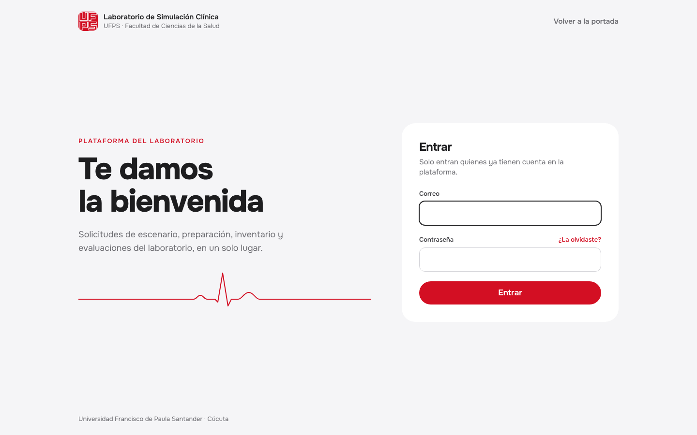

# Información del documento

## Identificación

| Campo | Valor |
|---|---|
| Título | Manual de usuario del administrador de la plataforma |
| Sistema | Plataforma web del Laboratorio de Simulación Clínica |
| Organización | Laboratorio de Simulación Clínica, Facultad de Ciencias de la Salud, UFPS (Cúcuta) |
| Versión del documento | 1.0 |
| Versión del software descrita | Rama principal del repositorio a 25 de noviembre de 2026 (incluye el código de sala opcional) |
| Público | Administrador de la plataforma (rol ADMIN) |
| Autor | Kevin David Zorro Hernández, practicante de Ingeniería de Sistemas |
| Revisión | Ing. Arturo Zambrano Contreras, jefe inmediato |
| Normas de referencia | ISO/IEC/IEEE 26514:2022 (diseño y desarrollo de información para usuarios), ISO/IEC/IEEE 26511 y 26512 (gestión y adquisición de información para usuarios) |

## Control de versiones

| Versión | Fecha | Autor | Cambios |
|---|---|---|---|
| 1.0 | 26/11/2026 | Kevin David Zorro Hernández | Primera versión, escrita a partir del código de la plataforma. |

## Cómo mantener este manual al día

Este manual describe la plataforma tal como está en el código. Cuando cambie una pantalla o una regla que aquí se explica, actualice la sección correspondiente, suba la versión del documento y anote el cambio en la tabla de control de versiones. La fuente del manual es el archivo `docs/manual-administrador/manual-de-usuario-administrador.md` del repositorio; las versiones en Word y PDF se generan a partir de él.

# 1. Introducción

## 1.1 Propósito

Este manual explica cómo usar la plataforma del Laboratorio de Simulación Clínica con el rol de **administrador de la plataforma** (ADMIN). Describe cada función que tiene ese rol, paso a paso, y qué hacer cuando algo no sale como se espera.

## 1.2 Alcance

El manual cubre:

- La entrada a la plataforma, la recuperación de la contraseña y la duración de la sesión.
- La gestión de cuentas de usuario y de roles, incluidos los roles temporales y los docentes supervisores.
- La administración de la estructura académica (materias, casos clínicos, tipos de evaluación, salas y ajustes) y del contenido público de la portada.
- Las funciones operativas que el ADMIN conserva: aprobar o rechazar solicitudes revisadas, nivel de fidelidad del inventario, periodo académico, plantillas y formatos de confidencialidad, bloqueos, bitácora, depuración de datos y reportes.
- Los correos que envía la plataforma.
- Los datos de demostración para probar el flujo completo.

No cubre la instalación ni el mantenimiento del servidor. Lo poco que el ADMIN puede necesitar de la consola del servidor está en el Anexo A, y la guía completa del servidor está en `docs/despliegue-nativo.md`. Las funciones de los demás roles (docente, administrativo, estudiante…) solo se mencionan cuando hacen falta para entender lo que hace el ADMIN.

## 1.3 Público objetivo

El manual está escrito para la persona que administra la plataforma en el laboratorio. Se asume que sabe usar un navegador web y el correo electrónico. **No** se asume que conozca Laravel, PHP, bases de datos ni la administración de servidores.

## 1.4 Cómo está organizado

| Capítulo | Contenido |
|---|---|
| 2. Convenciones | Cómo leer los pasos, avisos y nombres de pantalla. |
| 3. Antes de empezar | Requisitos, dirección de acceso y la cuenta de ADMIN. |
| 4. Descripción general | Qué es la plataforma, sus roles y sus dos paneles. |
| 5. Entrar, salir y la sesión | Entrada con correo y contraseña, recuperación, duración de la sesión, cambio de rol. |
| 6. Usuarios y roles | Crear y editar cuentas, asignar y revocar roles, deshabilitar, supervisión. |
| 7. Panel de administración | Estructura académica, ajustes y contenido público. |
| 8. Funciones operativas del ADMIN | Solicitudes, inventario, periodo, confidencialidad, bloqueos, bitácora, depuración y reportes. |
| 9. Correos de la plataforma | Qué correos salen, a quién y cuándo. |
| 10. Datos de demostración | Cómo probar todo el flujo y cómo borrarlo. |
| 11. Mensajes y solución de problemas | Mensajes frecuentes, su causa y qué hacer. |
| 12. Preguntas frecuentes | Respuestas cortas. |
| 13. Glosario | Términos del laboratorio y de la plataforma. |
| 14. Soporte y contacto | A quién acudir. |
| Anexo A | Tareas en el servidor (breve). |

# 2. Convenciones del manual

| Convención | Significado |
|---|---|
| **Negrita** | Nombre de un botón, enlace, campo o sección tal como aparece en la pantalla. Ejemplo: pulse **Guardar**. |
| `Texto monoespaciado` | Algo que se escribe tal cual: una dirección, un comando o un valor. |
| Menú › Opción | Camino de navegación. Ejemplo: **Administración › Estructura académica › Salas**. |
| *Nota* | Información útil que no cambia el resultado. |
| *Importante* | Algo que, si se ignora, produce un error o una pérdida de datos. |
| Pasos numerados | Se hacen en orden. Cada procedimiento dice al final qué resultado debe ver. |

En la plataforma, el rol de administrador se llama **Administrador de la plataforma**. En este manual se usa también la sigla **ADMIN**, que es como lo llaman los documentos del proyecto.

# 3. Antes de empezar

## 3.1 Requisitos

- Un computador o celular con un navegador actual (Chrome, Edge, Firefox o Safari, en sus versiones de los últimos dos años).
- Conexión a la red desde la que se alcanza el servidor de la plataforma.
- Una cuenta en la plataforma con el rol de **Administrador de la plataforma** y una contraseña, o una cuenta institucional de Google cuando esa entrada esté habilitada.
- Acceso al correo de esa cuenta, para recuperar la contraseña y recibir los avisos.

## 3.2 Dirección de acceso

La plataforma se abre en la dirección configurada para el laboratorio. Mientras el servidor no tenga dominio propio con `https`, se entra por la dirección que entregue el área de sistemas (por ejemplo, mediante un túnel). *Importante:* la plataforma se ve bien solo por la dirección exacta que tiene configurada; si la abre por otra (por ejemplo, por la IP sin el puerto), la página puede salir sin estilos. Ver la sección 11.

| Dirección | Qué es |
|---|---|
| `/` | Portada pública del laboratorio. No pide sesión. |
| `/acceso` | Pantalla de entrada. |
| `/panel` | Panel interno: la pantalla **Hoy** y el menú lateral. |
| `/admin` | Panel de administración (estructura académica y contenido público). Solo para el ADMIN. |

## 3.3 La cuenta de ADMIN

La primera cuenta de ADMIN no se crea desde la pantalla: la crea quien administra el servidor con un comando (Anexo A). Después, un ADMIN puede dar el rol de ADMIN a otras personas desde **Usuarios y roles** (sección 6).

*Importante:* nadie puede quitarse a sí mismo el rol de ADMIN ni deshabilitar su propia cuenta. Así la plataforma no se queda sin administrador por error. Si hace falta, lo hace otro ADMIN.

# 4. Descripción general de la plataforma

## 4.1 Qué hace

La plataforma reemplaza los procesos manuales del laboratorio: solicitud y reserva de escenarios clínicos, preparación de salas, inventario de simuladores e insumos, evaluación de habilidades, formato de confidencialidad, reportes y la portada pública que presenta el laboratorio.

## 4.2 Los seis roles

| Rol | Qué hace |
|---|---|
| Administrador de la plataforma | Administra la plataforma: contenido público, usuarios, materias, casos clínicos, tipos de evaluación y el nivel de fidelidad del inventario. |
| Coordinador | Aprueba o rechaza solicitudes de escenario, verifica formatos y genera reportes. Hereda todos los permisos del administrativo. |
| Administrativo | Revisa solicitudes, asigna sala, prepara escenarios y gestiona el inventario. |
| Docente | Solicita escenarios, registra evaluaciones de habilidades y entrega el formato de confidencialidad. |
| Docente supervisor | Consulta los resultados de las evaluaciones que hacen los docentes que el ADMIN le asignó. No solicita escenarios, no evalúa y no gestiona nada más. |
| Estudiante | Consulta sus resultados y entrega el formato de confidencialidad. |

Una persona puede tener varios roles a la vez, y un rol puede tener fecha de fin (rol temporal). El rol con el que se trabaja en cada momento es el **rol activo**, y se cambia con el selector del menú lateral (sección 5.5).

## 4.3 Los dos paneles

La plataforma tiene dos zonas de trabajo:

- **Panel interno (`/panel`).** Es donde se hace el trabajo diario: solicitudes, calendario, inventario, formatos, usuarios, bitácora, reportes. El menú lateral muestra solo lo que el rol activo puede usar.
- **Panel de administración (`/admin`).** Pantallas de alta y edición sin reglas de negocio: la estructura académica y el contenido de la portada pública. Se llega desde la opción **Administración** del menú lateral. Solo lo ve el ADMIN.

## 4.4 Menú del ADMIN

Con el rol de ADMIN activo, el menú lateral del panel muestra:

| Opción | Para qué | Sección |
|---|---|---|
| Hoy | Lo que espera su atención: solicitudes por aprobar, formatos por verificar, datos para depurar. | 8.1 |
| Calendario | Todas las sesiones del laboratorio. | 8.2 |
| Solicitudes | Bandeja de solicitudes; el ADMIN aprueba o rechaza las revisadas. | 8.3 |
| Evaluaciones | Consulta de las evaluaciones registradas. | 8.10 |
| Inventario | Ítems del inventario; el ADMIN es el único que fija el nivel de fidelidad. | 8.4 |
| Insumos por pedir | Lista de reposición del semestre. | 8.5 |
| Formatos de confidencialidad | Verificación de los formatos entregados y quién lo tiene al día. | 8.7 |
| Plantillas de confidencialidad | La plantilla en PDF que todos descargan y firman. | 8.7 |
| Bloqueos de acceso | Bloquear y levantar el bloqueo de estudiantes y docentes. | 8.8 |
| Periodo académico | Abrir, cerrar y reabrir el periodo. | 8.6 |
| Usuarios y roles | Cuentas, roles, habilitación y supervisión. | 6 |
| Administración | Abre el panel de administración (`/admin`). | 7 |
| Bitácora | Registro de auditoría. | 8.9 |
| Depuración de datos | Borrar lo que tiene más de dos semestres. | 8.11 |
| Reportes | Reportes en pantalla, PDF y Excel. | 8.10 |

Al final del menú están el selector de rol (si tiene más de uno) y el botón **Salir**.

# 5. Entrar, salir y la sesión

## 5.1 Entrar con correo y contraseña

1. Abra la dirección de la plataforma y pulse **Entrar**, o vaya directamente a `/acceso`.
2. En **Correo**, escriba el correo de su cuenta.
3. En **Contraseña**, escriba su contraseña.
4. Pulse **Entrar**.

**Resultado:** se abre el panel en la pantalla **Hoy**. Si había intentado abrir otra página antes de entrar, la plataforma lo lleva a esa página.

*Nota:* solo entran quienes ya tienen cuenta en la plataforma. Tener un correo de la universidad no basta.

## 5.2 Entrar con Google

Cuando el laboratorio tenga dominio con `https` y la entrada con Google esté configurada, la pantalla de entrada muestra también **Entrar con Google**. Se entra con la cuenta institucional (la que termina en el dominio de la universidad). Mientras no esté configurada, ese botón no aparece y se entra solo con correo y contraseña.

## 5.3 Recuperar o elegir la contraseña

Este procedimiento sirve tanto para quien olvidó su contraseña como para quien nunca ha tenido una (por ejemplo, una cuenta recién creada).

1. En la pantalla de entrada, pulse **¿Olvidaste tu contraseña?**.
2. Escriba el correo de la cuenta y pulse **Enviar el enlace**.
3. Abra el correo **Recupera tu contraseña** y pulse el enlace. Si no lo ve en uno o dos minutos, revise las carpetas de spam y promociones.
4. En **Contraseña nueva**, escriba una contraseña de **12 a 72 caracteres**. Una frase de varias palabras es fácil de recordar y difícil de adivinar.
5. Repítala en **Repítela** y pulse **Guardar la contraseña**.

**Resultado:** aparece el mensaje «Tu contraseña quedó guardada. Ya puedes entrar con ella.» y le llega el correo **Tu contraseña cambió**.

Reglas que conviene conocer:

- El enlace vale **60 minutos** y sirve **una sola vez**.
- Si pide otro enlace, el anterior deja de servir.
- Entre un envío y otro hay que esperar, y la espera crece con cada envío (1, 3, 5, 10… minutos). Se reinicia al día siguiente.
- Por seguridad, la pantalla dice lo mismo exista o no la cuenta: no revela qué correos están registrados.
- **Al cambiar la contraseña se cierran las demás sesiones abiertas** de esa cuenta, en cualquier equipo.

## 5.4 Duración de la sesión

| Regla | Qué pasa |
|---|---|
| 60 minutos sin actividad | La sesión vence y hay que volver a entrar. |
| 24 horas desde que entró | La sesión se cierra aunque se esté usando, con el aviso «Por seguridad, la sesión se cierra a las 24 horas de haber entrado. Vuelve a entrar.» |
| Cuenta deshabilitada o sin vigencia | Se cierra la sesión en la siguiente acción, aunque la pantalla esté abierta. |

*Nota:* si deja una pantalla abierta mucho tiempo y al pulsar un botón aparece un error de «página expirada» (419), recargue la página y, si hace falta, vuelva a entrar.

## 5.5 Cambiar de rol

Si su cuenta tiene más de un rol (por ejemplo, ADMIN y docente):

1. Al final del menú lateral, abra el selector de rol.
2. Elija el rol con el que quiere trabajar y pulse **Cambiar**.

**Resultado:** el menú y los permisos cambian a los de ese rol. Si el rol es temporal, el menú muestra «Rol temporal · hasta el dd/mm/aaaa».

## 5.6 Salir

Pulse **Salir** al final del menú lateral. Cierre siempre la sesión en equipos compartidos.

# 6. Usuarios y roles

Se llega por **Usuarios y roles** en el menú lateral. Es una pantalla del panel interno, no del panel de administración, porque deshabilitar cuentas y repartir roles tiene reglas (motivo, bitácora y vigencia).

## 6.1 Qué muestra la pantalla

- Un buscador por nombre, correo o código.
- El botón **Nueva cuenta**.
- Una tarjeta por persona con su nombre, correo, origen de la cuenta (Matriculado, Contratado o Creado en la plataforma), programa, sus roles y los botones de acción.
- Si algún rol temporal vence en los próximos **14 días**, un aviso arriba: «Vencen en los próximos 14 días», con quién y qué rol.

Estados que puede ver en una tarjeta:

| Texto | Significado |
|---|---|
| «Deshabilitada el dd/mm/aaaa: motivo» | El ADMIN la deshabilitó. No puede entrar hasta que un ADMIN la vuelva a habilitar. |
| «Sin vigencia institucional: no puede entrar.» | La sincronización con la universidad la marcó inactiva (por ejemplo, un egresado). |
| «Sin ningún rol asignado.» | La cuenta existe pero no tiene rol. Al entrar no verá casi nada. |
| «· temporal hasta dd/mm/aaaa» | El rol vence solo al terminar ese día. |

## 6.2 Crear una cuenta

1. Pulse **Nueva cuenta**.
2. Llene **Nombre completo** y **Correo institucional** (obligatorios). El correo no puede repetirse.
3. Si los tiene, llene **Documento**, **Código institucional** y **Programa** (opcionales).
4. Pulse **Guardar**.
5. Asígnele uno o más roles (sección 6.4).
6. Pídale a la persona que entre a `/acceso`, pulse **¿Olvidaste tu contraseña?** y elija su contraseña (sección 5.3).

**Resultado:** la cuenta queda con origen «Creado en la plataforma».

*Nota:* el ADMIN no elige ni ve contraseñas de otras personas. Cada persona elige la suya con el enlace del correo.

## 6.3 Editar los datos de una cuenta

1. Busque a la persona y pulse **Editar datos**.
2. Corrija lo necesario y pulse **Guardar**.

*Importante:* si la cuenta viene de la base institucional, la pantalla lo advierte: lo que cambie lo volverá a escribir la siguiente sincronización. Un dato mal escrito en una cuenta institucional hay que corregirlo en la universidad.

## 6.4 Asignar un rol

1. Busque a la persona y pulse **Asignar un rol**.
2. En **Rol**, elija el rol.
3. Si el rol es temporal, elija la fecha en **Hasta**. El rol vale todo ese día y deja de tener efecto al día siguiente. Vacío significa permanente.
4. Si el rol es **Coordinador**, escriba el **Motivo de la delegación** (obligatorio).
5. Pulse **Asignar**.

**Resultado:** el rol aparece en la tarjeta y la asignación queda en la bitácora.

Casos típicos:

- **Pasante:** rol Administrativo con fecha de fin en el día que se retira.
- **Delegación de la coordinación:** rol Coordinador con fecha de fin y el motivo (por ejemplo, «Consejo de facultad del 2 al 6 de diciembre»).

*Nota:* un rol temporal vence solo; no hay que hacer nada ese día. Lo que la persona hizo con ese rol (por ejemplo, una solicitud aprobada) sigue valiendo después.

## 6.5 Revocar un rol

1. En la tarjeta de la persona, pulse **Revocar** junto al rol.

**Resultado:** el rol se quita en el acto. Si la persona tenía una pantalla abierta con ese rol, su siguiente acción es rechazada. El rastro (quién asignó, quién revocó y cuándo) se conserva.

## 6.6 Deshabilitar o volver a habilitar una cuenta

1. En la tarjeta, pulse **Deshabilitar** (o **Volver a habilitar**).
2. Escriba el motivo en **Por qué se deshabilita** (o **Por qué se vuelve a habilitar**).
3. Confirme con **Deshabilitar** (o **Habilitar**).

**Resultado:** la persona no puede entrar, y si tenía la sesión abierta, se le cierra en su siguiente acción. Queda en la bitácora con el motivo. Sus solicitudes, evaluaciones y formatos se conservan.

*Nota:* deshabilitar no es lo mismo que la vigencia institucional. La sincronización nunca vuelve a habilitar una cuenta que el ADMIN deshabilitó.

## 6.7 Asignar docentes a un docente supervisor

1. Asigne a la persona el rol **Docente supervisor** (sección 6.4).
2. En su tarjeta, pulse **Docentes a su cargo**.
3. Busque al docente por nombre o correo y pulse **Asignar**. Repita con cada docente.
4. Para quitar uno, pulse **Retirar** junto a su nombre.

**Resultado:** el supervisor ve en **Evaluaciones de mis docentes** los resultados de las evaluaciones de esos docentes, en pantalla, PDF y Excel.

Reglas: solo se asignan personas con el rol de docente vigente, y un supervisor no puede supervisarse a sí mismo.

# 7. Panel de administración

Se abre desde **Administración** en el menú lateral, o en `/admin`. Tiene dos grupos en su menú: **Estructura académica** y **Contenido público**.

Todas las listas del panel funcionan igual:

1. Pulse el nombre del recurso en el menú (por ejemplo, **Materias**).
2. Para crear, pulse el botón de nuevo registro (arriba a la derecha), llene el formulario y pulse **Crear**.
3. Para editar, pulse el registro en la lista, cambie lo necesario y pulse **Guardar cambios**.
4. Use el buscador y los filtros de la lista para encontrar registros.

*Importante:* los registros de la **estructura académica no se borran**: se desactivan. Están ligados a solicitudes y evaluaciones históricas, y borrarlos rompería ese historial. El contenido público, en cambio, sí se puede borrar y reordenar.

## 7.1 Estructura académica

### Materias

| Campo | Detalle |
|---|---|
| Código | Obligatorio y único. |
| Nombre | Obligatorio. |
| Semestre | Obligatorio, número desde 1. |
| Activa | Una materia inactiva no aparece en el formulario de solicitud del docente. |

### Casos clínicos

| Campo | Detalle |
|---|---|
| Nombre y Descripción | Obligatorios. |
| Capacidad máxima de estudiantes | Cuántos estudiantes admite el escenario. Si se deja vacía, no limita las solicitudes. |
| Materias | Materias en las que se usa el caso. El docente solo lo ve al solicitar para esas materias. |
| Ítems necesarios | Ítem del inventario y cantidad. Se precargan en la solicitud del docente. |
| Imagen | Foto del escenario para la portada. |
| Activo | Un caso inactivo no aparece en el formulario de solicitud del docente. |
| Visible en la landing | Lo muestra en la portada. Solo sale si además está activo. |

### Tipos de evaluación

| Campo | Detalle |
|---|---|
| Nombre y Descripción | El nombre es obligatorio. |
| Materias | Dónde se usa este tipo. |
| Ítems del checklist | Lista de ítems que el docente marca al evaluar. |
| Activo | Un tipo inactivo no admite evaluaciones nuevas; las ya creadas lo conservan. |

*Nota:* al crear una evaluación, sus ítems se **copian** del checklist. Si edita el checklist después, las evaluaciones ya hechas conservan los ítems originales. Es intencional.

### Salas

| Campo | Detalle |
|---|---|
| Código | **Opcional.** Si lo pone, no puede repetirse. En la lista, una sala sin código dice «Sin código». |
| Nombre | Obligatorio. Se puede cambiar cuando quiera. |
| Bloque, Piso y Número de sala | Obligatorios. Si cambia la ubicación, la anterior queda en **Ubicaciones anteriores**. |
| Escenarios que se montan aquí | Al preparar, estas salas se ofrecen primero para esos escenarios. No impide usar otra sala libre. |
| Capacidad (personas) | Cuánta gente cabe en el espacio físico. |
| Activa | Una sala inactiva no se ofrece al asignar sala en la preparación. |

*Nota:* una sesión puede usar de una a tres salas a la vez (las que se unen abriendo las cortinas). La sala la asigna el administrativo al preparar, no el docente ni el ADMIN.

### Ajustes del laboratorio

Valores que el ADMIN cambia sin tocar el servidor.

| Ajuste | Detalle |
|---|---|
| Días de aviso del formato intramural | Con cuántos días de antelación se avisa por correo a los administrativos y al docente de una sesión que todavía no tiene formato intramural. Por defecto, 3; máximo, 60. |

Cambie el valor y pulse **Guardar**.

## 7.2 Contenido público (portada)

Todo lo que muestra la portada pública (`/`) se carga aquí. Cada elemento tiene una casilla **Publicado** o **Publicada**: si está apagada, el elemento se conserva pero no sale en la portada. Mientras no haya fotos reales, cada bloque se ve completo sin foto.

| Pantalla | Qué se carga |
|---|---|
| Configuración de la landing | Título y subtítulo de la portada, video de fondo, correo, teléfono y dirección de contacto. |
| Galería de fotos | Fotos o videos con su título. El título es también el texto alternativo para quien no puede ver la imagen. |
| Estadísticas | Cifra («22», «+700», «98 %») y lo que la acompaña («simuladores disponibles»). |
| Talleres | Título, descripción, tema, fecha, modalidad, imagen o video y, si quiere, el formulario de interés para que los visitantes dejen sus datos. La columna **Interesados** cuenta cuántos lo hicieron. |
| Eventos | Título, descripción, fecha, tipo de evento, imagen o video y si es abierto al público o solo para la comunidad universitaria. |
| Tipos de evento | Lista de tipos para clasificar los eventos. No se borran: se desactivan. |
| Certificaciones | Nombre, entidad que la otorga, descripción e insignia. |
| Perfiles docentes | Nombre, cargo, foto, títulos (título e institución) y, opcional, la cuenta del docente en la plataforma. |
| Equipamiento destacado | Nombre corto, una frase, foto o video y la lista «Lo que permite». |

Reglas para las imágenes y los videos:

| Tipo | Formatos | Tamaño máximo | Qué hace la plataforma |
|---|---|---|---|
| Imagen | JPEG, PNG o WebP | 5 MB | La endereza, la reduce a 1600 px de lado mayor y la guarda en WebP. |
| Video de fondo (landing) | MP4 o WebM ya comprimido | 15 MB | Lo guarda tal cual. |
| Video de galería, taller, evento, escenario o equipo | MP4 o WebM ya comprimido | 30 MB (unos 90 segundos a 720p) | Lo guarda tal cual. No se aceptan enlaces de YouTube. |

*Nota:* los videos no se reproducen solos en la portada. Al reemplazar una imagen o un video, el archivo anterior se borra.

Para cambiar el orden en que salen los elementos, use el control de reordenar de la lista.

# 8. Funciones operativas del ADMIN

## 8.1 Pantalla «Hoy»

Es la primera pantalla después de entrar. Muestra solo lo que espera su atención con el rol activo, por ejemplo:

- **Por aprobar:** solicitudes ya revisadas por un administrativo.
- **Formatos por verificar.**
- **Datos de más de dos semestres:** aviso de que hay datos para depurar.

Si no hay nada, dice «Nada pendiente por ahora».

## 8.2 Calendario

Muestra todas las sesiones del laboratorio. Pulse una sesión para ver su detalle.

## 8.3 Aprobar o rechazar solicitudes

El flujo de una solicitud es: el docente solicita → un administrativo la acepta (queda **Revisada**) o la rechaza → coordinación **o el ADMIN** la aprueba o la rechaza → un administrativo asigna sala y prepara.

El ADMIN aprueba cuando la coordinación no está disponible, pero **no revisa**: solo resuelve solicitudes en estado **Revisada**.

Para aprobar:

1. Abra **Solicitudes** (o el bloque **Por aprobar** de **Hoy**) y pulse la solicitud.
2. Revise el detalle: docente, materia, caso clínico, fecha, estudiantes e ítems pedidos.
3. Si el sistema detecta que faltan unidades del inventario, escriba en **Observaciones de la aprobación** qué falta: en ese caso son obligatorias y le llegan al docente en el correo.
4. Pulse **Aprobar**.

**Resultado:** se crea la preparación, el docente recibe el correo **Su solicitud de escenario fue aprobada** y la aprobación queda en la bitácora.

Para rechazar:

1. Abra la solicitud y pulse **Rechazar**.
2. Escriba el **Motivo del rechazo** y pulse **Confirmar rechazo**.

**Resultado:** el docente recibe **Su solicitud de escenario fue rechazada** con el motivo.

*Nota:* una solicitud cuya fecha pasó sin resolverse está **vencida**: no se puede revisar ni aprobar, solo rechazar para cerrarla. La bandeja tiene el filtro **Vencidas**.

## 8.4 Inventario y nivel de fidelidad

El ADMIN puede registrar y editar ítems del inventario, cambiar su estado funcional y darlos de baja, igual que coordinación. Lo exclusivo del ADMIN es el **Nivel de fidelidad** de los simuladores (Baja, Media o Alta fidelidad).

1. Abra **Inventario** y pulse **Editar** en el simulador.
2. Elija el **Nivel de fidelidad** y pulse **Guardar**.

*Nota:* todo cambio de unidades (en revisión, defectuosas, retiradas o repuestas) exige cantidad y motivo, y queda en el historial del ítem. Dar de baja unidades defectuosas es definitivo.

## 8.5 Insumos por pedir (lista de reposición)

La lista de reposición es el soporte de la carta de solicitud de compra del semestre. Mientras está en borrador se calcula al vuelo; al cerrarla, sus cifras quedan congeladas. **Cerrar es irreversible** y solo lo pueden hacer coordinación y el ADMIN. Solo se descargan (PDF o Excel) listas cerradas.

## 8.6 Periodo académico

El periodo académico decide qué formatos de confidencialidad están vigentes. Lo abre y lo cierra el laboratorio; la plataforma nunca lo deduce del calendario.

Para abrir un periodo:

1. Abra **Periodo académico**.
2. Escriba el **Nombre del periodo** (por ejemplo, `2027-1`) y pulse **Abrir el periodo**.

**Resultado:** el periodo queda abierto y recibe formatos. *Importante:* al abrirlo, todos deben entregar de nuevo el formato de confidencialidad.

Para cerrarlo, pulse **Cerrar el periodo** y confirme. Ciérrelo cuando termine el semestre: lo entregado sigue valiendo hasta que se abra el siguiente, pero no se reciben formatos nuevos. Solo se puede **Reabrir** el último periodo cerrado, y no se abre uno nuevo mientras otro siga abierto.

## 8.7 Formato de confidencialidad

El formato de confidencialidad es el documento que firman estudiantes y docentes para entrar a las prácticas, e incluye la autorización de captación de imágenes.

**Cargar la plantilla (solo el ADMIN):**

1. Abra **Plantillas de confidencialidad**.
2. Escriba el **Nombre** y la **Versión**, elija el **Archivo PDF** y pulse **Cargar plantilla**.

**Resultado:** la plantilla nueva queda **Vigente** y la anterior pasa a **Retirada** automáticamente. Sin una plantilla vigente nadie puede entregar su formato.

**Verificar formatos:** la verificación diaria la hace el administrativo; el ADMIN conserva el permiso y supervisa. En **Formatos de confidencialidad** se ven las entregas; **Ver quién lo tiene al día** muestra el estado de cada firmante. Cada descarga de un formato firmado queda en la bitácora. Un formato verificado ya no se reemplaza.

## 8.8 Bloqueos de acceso

Quien está bloqueado no puede ingresar al laboratorio ni ser evaluado, y un docente bloqueado tampoco puede solicitar escenarios.

1. Abra **Bloqueos de acceso** y busque a la persona por nombre, correo o código.
2. Pulse **Elegir**, escriba el **Motivo** y pulse **Bloquear**.

Para levantar un bloqueo, pulse **Levantar** junto a él, escriba el motivo y pulse **Levantar el bloqueo**. Los bloqueos no se borran: se levantan y quedan en el historial (casilla **Incluir los levantados**).

## 8.9 Bitácora

Registro de auditoría de las acciones importantes: aprobaciones y rechazos, reprogramaciones, sustituciones, bloqueos, cambios de roles, habilitación de cuentas, verificación y descarga de formatos, apertura y cierre de periodos, evaluaciones finalizadas, exportaciones de reportes y accesos negados.

Filtre por **Acción**, **Quién**, **Desde** y **Hasta**; **Limpiar filtros** los quita. Cada entrada muestra la acción, la fecha y hora, quién la hizo, la descripción y, si lo hubo, el motivo. La bitácora no se edita.

## 8.10 Reportes y evaluaciones

En **Reportes** elija el reporte, el rango de fechas y los filtros (docente, materia, sala) y consulte en pantalla o descargue.

| Reporte | Contenido |
|---|---|
| Uso de escenarios clínicos | Sesiones, horas y estudiantes por docente, materia, caso clínico, sala y tipo de sesión. Solo solicitudes aprobadas. |
| Resultados de evaluación | Un renglón por estudiante evaluado, con su intento y su resultado. Solo evaluaciones finalizadas. |
| Evaluaciones no registradas | Escenarios de evaluación que ya pasaron y cuya evaluación no se registró o quedó en borrador. |
| Lista de insumos por pedir o reponer | Insumos de una lista cerrada. |

*Nota:* el **PDF** admite como máximo 31 días y 500 filas. Para periodos más largos descargue el **Excel**, que no tiene ese tope. Cada exportación queda en la bitácora.

En **Evaluaciones** el ADMIN consulta las evaluaciones registradas. No las crea: eso lo hace el docente. El resultado (aprobado o no aprobado) lo decide siempre el docente.

## 8.11 Depuración de datos

La plataforma conserva dos periodos académicos: el vigente y el anterior. Lo más viejo lo depura el ADMIN a mano; **nada se borra solo**.

1. Abra **Depuración de datos**. La pantalla dice qué periodos se conservan y cuánto hay para depurar (evaluaciones, entradas de la bitácora y documentos de formatos firmados).
2. Si hay formatos, pulse **Descargar los formatos en un ZIP** y guárdelos donde el laboratorio los conserva.
3. Marque **Ya descargué los formatos y los guardé donde el laboratorio los conserva**.
4. Pulse **Depurar lo de más de dos semestres**.

*Importante:* **depurar no se deshace**. Del formato se borra el PDF, pero el registro de quién firmó y quién verificó se conserva.

# 9. Correos de la plataforma

Los correos salen de la cuenta de correo configurada para el laboratorio y se envían en segundo plano, normalmente en uno o dos minutos. Si una entrega falla, la plataforma lo reintenta.

| Asunto | A quién | Cuándo |
|---|---|---|
| Recupera tu contraseña | Quien lo pide | Al pedir el enlace en «¿Olvidaste tu contraseña?». |
| Tu contraseña cambió | Dueño de la cuenta | Al cambiar la contraseña. |
| Su solicitud de escenario fue aprobada | Docente | Al aprobar la solicitud, con las observaciones. |
| Su solicitud de escenario fue rechazada | Docente | Al rechazarla, con el motivo. |
| Sala asignada para su sesión / Cambió la sala de su sesión | Docente | Al asignar o cambiar la sala. |
| Su sesión fue reprogramada | Docente | Al cambiar la fecha, la franja o el escenario. |
| Le asignaron una sesión por sustitución | Docente reemplazo | Al sustituir al docente de una sesión. |
| Una sesión próxima no tiene formato intramural (o «N sesiones próximas…») | Docente y administrativos activos | Cada día a las 6:00 a. m., con la antelación de **Ajustes del laboratorio**. |
| La sincronización de usuarios se detuvo sin aplicar cambios | Cada ADMIN | Cuando una sincronización con la universidad iba a desactivar demasiadas cuentas y se frenó. |

*Nota:* si recibe el correo de sincronización detenida, no se aplicó ningún cambio. Avise al área de sistemas para revisar la fuente de datos institucional.

Para ver cómo llega cada correo sin montar datos, quien administra el servidor puede enviar una muestra de todos (Anexo A).

# 10. Datos de demostración

Para probar a mano el flujo completo (solicitar, revisar, aprobar, rechazar, asignar sala, reprogramar, sustituir y recuperar contraseña) y ver llegar cada correo, quien administra el servidor puede crear datos de demostración con el comando `demo:preparar` (Anexo A).

Qué crea:

- Cuentas que son alias de un correo dado: docente, segundo docente, administrativo y coordinación (por ejemplo, `nombre+docente@…`). Todas llegan al mismo buzón. Sus contraseñas se muestran **una sola vez** en la consola.
- Dos materias, cuatro casos clínicos y dos salas.
- Una solicitud por cada camino del flujo.

Todo lleva la marca `DEMO-` o `[Demo]`. El comando imprime qué hacer con cada cuenta para disparar cada correo:

1. **Aprobar y asignar sala:** el administrativo acepta, coordinación aprueba, el administrativo asigna sala.
2. **Rechazar:** el administrativo rechaza con un motivo.
3. **Ya revisada:** coordinación aprueba o rechaza.
4. **Ya aprobada sin sala:** asignar sala, reprogramar o cambiar de docente.
5. **Sin formato intramural:** el aviso de las 6:00 a. m.
6. **Contraseña:** «¿Olvidaste tu contraseña?» con cualquier cuenta.

Consejos para la prueba:

- Las ventanas privadas de un navegador comparten la sesión. Para tener varias cuentas abiertas a la vez use navegadores o perfiles distintos, o una cuenta a la vez (si no, aparece el error 419).
- Repetir el comando deja todo como recién hecho, con contraseñas nuevas.

*Importante:* **borre los datos de demostración antes de que entren datos reales**, con `demo:preparar --limpiar`. Solo borra lo marcado como demostración, incluido su rastro en la bitácora. Una cuenta de demostración que actuó sobre datos reales no se borra: queda deshabilitada. Una sala de demostración que usa una sesión real queda inactiva.

# 11. Mensajes y solución de problemas

## 11.1 Al entrar

| Mensaje o síntoma | Causa | Qué hacer |
|---|---|---|
| «El correo o la contraseña no son correctos.» | Correo o contraseña mal escritos, o la cuenta todavía no tiene contraseña. | Revise el correo. Si no recuerda la contraseña o nunca la eligió, use «¿Olvidaste tu contraseña?». |
| «Demasiados intentos. Vuelve a intentarlo en N segundos.» | Más de 5 intentos por minuto, o más de 20 en 15 minutos contra la misma cuenta. | Espere el tiempo indicado. Si no fue usted, cambie la contraseña. |
| «No hay una cuenta de la plataforma para ese correo…» | No existe cuenta con ese correo (entrada con Google). | Cree la cuenta en **Usuarios y roles** (sección 6.2). |
| «Tu cuenta está deshabilitada en la plataforma…» | Un ADMIN la deshabilitó. | Otro ADMIN la vuelve a habilitar (sección 6.6). |
| «Tu vinculación con la institución no está vigente…» | La sincronización la marcó inactiva. | Se corrige en la universidad; no se cambia a mano. |
| «Entra con tu cuenta institucional, la que termina en @…» | Usó una cuenta de Google de otro dominio. | Entre con la cuenta institucional. |
| «La entrada con Google no está configurada del todo. Avisa al laboratorio.» | Falta configurar el dominio institucional en el servidor. | Avise al área de sistemas. Mientras tanto, entre con correo y contraseña. |
| «Por seguridad, la sesión se cierra a las 24 horas…» | Pasaron 24 horas desde que entró. | Vuelva a entrar. |
| «Este enlace ya no sirve» | El enlace de recuperación venció (60 minutos) o ya se usó. | Pulse **Pedir otro enlace**. |
| No llega el correo de recuperación. | Spam, espera entre envíos, o el correo del servidor no está configurado. | Revise spam y promociones; espere unos minutos. Si sigue sin llegar, avise al área de sistemas (Anexo A, cola de correos). |
| La página sale sin estilos o los botones no responden. | Se abrió por una dirección distinta a la configurada. | Use la dirección oficial de la plataforma. |
| Error 419 (página expirada). | La pantalla estuvo abierta mucho tiempo, o hay dos cuentas en el mismo navegador. | Recargue y vuelva a entrar. Use una cuenta por navegador. |
| Error 403 (acceso negado). | El rol activo no tiene permiso para esa pantalla o acción. | Cambie al rol correcto (sección 5.5). El intento queda en la bitácora. |

## 11.2 Al administrar usuarios y roles

| Mensaje | Qué hacer |
|---|---|
| «Ya hay una cuenta con el correo …» | Busque esa cuenta y edítela en lugar de crear otra. |
| «Elevar a coordinador exige escribir el motivo de la delegación.» | Escriba el motivo. |
| «Esta persona ya tiene el rol de … vigente.» | No hace falta asignarlo de nuevo. Para cambiar la fecha de fin, revoque y vuelva a asignar. |
| «La fecha de fin (…) ya pasó: elige hoy o una fecha posterior.» | Corrija la fecha en **Hasta**. |
| «Nadie se quita a sí mismo el rol de ADMIN…» / «No puede deshabilitar su propia cuenta.» | Pídaselo a otro ADMIN. |
| «Esta persona no tiene vigente el rol de docente supervisor: asígnaselo primero.» | Asigne el rol antes de ponerle docentes a cargo. |
| «Solo se pueden asignar docentes: esta persona no tiene vigente el rol de docente.» | Asigne el rol de docente a esa persona, o elija a otra. |

## 11.3 En la operación

| Mensaje | Qué hacer |
|---|---|
| «Faltan unidades de algunos equipos en esa franja: escribe en las observaciones qué falta…» | Escriba en las observaciones de la aprobación qué falta. |
| «La fecha de esta solicitud (…) ya pasó: no se puede revisar ni aprobar…» | Recházela para cerrarla. |
| «El periodo … sigue abierto: ciérrelo antes de abrir otro.» | Cierre el periodo actual primero. |
| «Solo se puede reabrir el último periodo cerrado…» | Solo el último cerrado se reabre. |
| «No hay plantilla de confidencialidad activa…» | Cargue la plantilla (sección 8.7). |
| «No hay un periodo académico abierto…» | Abra el periodo (sección 8.6). |
| «El PDF admite rangos de hasta 31 días…» / «El reporte tiene más de 500 filas…» | Acorte el rango o descargue el Excel. |
| «El archivo no es una imagen JPEG, PNG o WebP que se pueda abrir.» | Use otro archivo o conviértalo. |
| «La imagen mide … píxeles: pasa del máximo…» | Reduzca la imagen antes de subirla. |
| Al subir un video aparece un error. | Revise que sea MP4 o WebM y no pase de 15 MB (fondo) o 30 MB (demás). Si cumple y falla, avise al área de sistemas. |
| «Esta lista ya está cerrada…» | Una lista de reposición cerrada no cambia. Lo nuevo entra en la siguiente. |
| «Depurar no se deshace» | Es una advertencia: descargue antes los formatos. |

# 12. Preguntas frecuentes

**¿Puedo ver o fijar la contraseña de otra persona?**
No. Cada persona elige la suya con «¿Olvidaste tu contraseña?». Solo desde la consola del servidor se puede fijar una (Anexo A).

**¿Cómo borro una materia, un caso clínico o una sala?**
No se borran: se desactivan, porque están ligados al historial. Un registro inactivo deja de ofrecerse en los formularios.

**¿Cómo borro un usuario?**
No se borran. Se deshabilitan (sección 6.6). Sus solicitudes, evaluaciones y formatos se conservan.

**La coordinadora sale de vacaciones. ¿Quién aprueba?**
El ADMIN puede aprobar las solicitudes revisadas. También puede delegar el rol de Coordinador a otra persona con fecha de fin y motivo (sección 6.4).

**¿Qué pasa cuando vence un rol temporal?**
Deja de tener efecto al día siguiente de la fecha **Hasta**, sin que nadie haga nada. Lo que la persona hizo con ese rol sigue valiendo.

**¿Por qué no veo un botón que otra persona sí ve?**
El menú y los botones dependen del rol activo. Revise el selector de rol.

**¿Se pierde algo si cierro el periodo académico?**
No. Lo entregado sigue valiendo hasta que se abra el siguiente periodo. Solo deja de recibir formatos nuevos.

**¿Cuánto tiempo se guardan los datos?**
Dos periodos académicos: el vigente y el anterior. Lo más viejo se depura a mano (sección 8.11).

**¿Los datos de demostración afectan los reportes?**
Sí, mientras existan. Bórrelos con `demo:preparar --limpiar` antes de usar la plataforma con datos reales.

**¿Los usuarios se cargan solos desde la universidad?**
La plataforma está preparada para sincronizar las cuentas con la base institucional, pero esa conexión depende de que la universidad dé acceso a sus datos. Mientras tanto, las cuentas se crean en **Usuarios y roles**.

# 13. Glosario

| Término | Definición |
|---|---|
| ADMIN | Administrador de la plataforma. |
| Bitácora | Registro de auditoría de las acciones importantes. No se edita. |
| Bloqueo | Impedimento que pone coordinación o el ADMIN a un estudiante o docente para entrar al laboratorio. Se levanta, no se borra. |
| Caso clínico / escenario clínico | La situación que se practica (atención de parto, herida por arma de fuego…). No es la sala. |
| Checklist | Lista de ítems que el docente marca al evaluar. |
| Deshabilitar | Impedir que una cuenta entre, con motivo. Lo hace el ADMIN y solo un ADMIN lo revierte. |
| Formato de confidencialidad | Documento que firman estudiantes y docentes para entrar a las prácticas; incluye la autorización de captación de imágenes. Se renueva cada periodo académico. |
| Formato intramural | Documento de la sesión con los insumos, equipos y simuladores que usa. |
| Grupo | La parte de la clase que pasa a los simuladores en una sesión (A, B, C…). |
| Intento | Número de vez que un estudiante presenta la misma evaluación. |
| Landing / portada | Página pública del laboratorio (`/`). |
| Nivel de fidelidad | Baja, media o alta fidelidad de un simulador. Solo lo registra el ADMIN. |
| Periodo académico | Semestre que abre y cierra el laboratorio. Define la vigencia de los formatos. |
| Preparación | Montaje físico del escenario antes de la clase. |
| Rol activo | El rol con el que se trabaja en ese momento. |
| Rol temporal | Rol con fecha de fin, que vence solo. |
| Sala | Espacio físico donde se monta el escenario. Una sesión usa de una a tres. |
| Sesión apartada | Sesión que registra un administrativo antes del semestre y nace aprobada. |
| Simulador | Maniquí de baja, media o alta fidelidad. |
| Solicitud | Pedido de un docente para usar un escenario, de tipo práctica o evaluación. Estados: Pendiente, Revisada, Aprobada, Rechazada. |
| Sincronización | Actualización de cuentas desde la base institucional de la universidad. |
| Vencida | Solicitud pendiente o revisada cuya fecha pasó sin resolverse. |
| Vigencia institucional | Si la persona sigue vinculada a la universidad. La escribe solo la sincronización. |

# 14. Soporte y contacto

| Necesidad | A quién acudir |
|---|---|
| Dudas de uso de la plataforma | Este manual; después, el administrador de la plataforma del laboratorio. |
| Servidor caído, correos que no salen, dominio, `https`, copias de seguridad | Área de sistemas de la UFPS (administrador del servidor). |
| Cambios en la plataforma o errores del software | Quien mantenga el código. La documentación técnica está en el repositorio: `README.md`, `CLAUDE.md` y la carpeta `docs/`. |

Al reportar un problema, indique: qué estaba haciendo, con qué rol, la fecha y hora, el mensaje exacto que vio y, si puede, una captura de pantalla. **Nunca envíe contraseñas** por correo ni por chat.

# Anexo A. Tareas en el servidor

Este anexo es para quien tiene acceso a la consola del servidor. Los comandos se ejecutan desde la carpeta de la aplicación (`/var/www/laboratorio`). La guía completa está en `docs/despliegue-nativo.md`.

| Tarea | Comando |
|---|---|
| Crear el primer ADMIN, o dar el rol de ADMIN a una cuenta | `./nativo.sh administrador correo@ufps.edu.co "Nombre Apellido"` (equivale a `php artisan usuarios:crear-administrador`) |
| Fijar la contraseña de una cuenta (la pide sin mostrarla) | `php artisan usuarios:contrasena correo@ufps.edu.co` |
| Generar una contraseña segura y mostrarla una sola vez | `php artisan usuarios:contrasena correo@ufps.edu.co --generar` |
| Enviar una muestra de cada correo | `php artisan correos:muestra correo@dominio` |
| Crear los datos de demostración | `php artisan demo:preparar correo@dominio --en-produccion` |
| Borrar los datos de demostración | `php artisan demo:preparar --limpiar --en-produccion` |
| Enviar ya el aviso de formato intramural | `php artisan sesiones:avisar-formato-intramural` |
| Actualizar la aplicación | `./nativo.sh actualizar` |
| Comprobar la instalación | `./nativo.sh verificar` |
| Volver a leer el `.env` después de cambiarlo | `php artisan optimize` |

Notas:

- **Cola y programador.** Los correos y el aviso de las 6:00 a. m. dependen del `cron` que instala `./nativo.sh cron`. Sin él, los correos no salen.
- **Copias.** `./nativo.sh copia` guarda la base y los archivos; el `cron` la corre a las 2:30 a. m. si está configurada la carpeta de copias. Guarde el `.env` aparte: sin la clave de la aplicación se pierden los documentos cifrados.
- **Registros.** Los errores de la aplicación están en `storage/logs/`.
- **Secretos.** Las contraseñas de la base y del correo viven solo en el `.env` del servidor, nunca en el repositorio ni en este manual.
